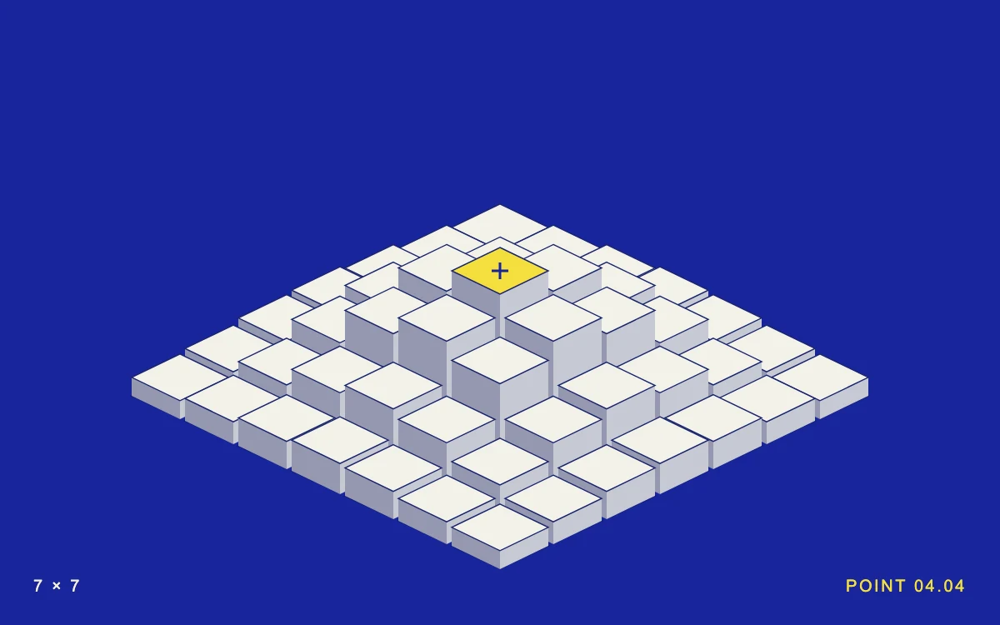

# Relief board

> Porcelain columns rise around a selected point on an ultramarine isometric field.

- **Common name:** Isometric hover grid
- **Category:** Animation & motion
- **Live demo:** https://www.subframe.com/motion/relief-board
- **Source:** Subframe (original, MIT)
- **Dependencies:** none

## Use case

Show a local influence radius through a legible three-dimensional surface.

## Interaction

Move across the field or select a point.

## Look

Saturated ultramarine field with a seven-by-seven isometric grid of off-white columns, one yellow top marked with a cross, and tiny letter-spaced corner captions.

## Motion

Columns rise in a Gaussian mound centred on the mouse-hovered or selected point, each easing out to its new height over 300 ms; keyboard selection updates instantly.

## How to adapt

Column height is `10 + Math.exp((-d * d) / 4.4) * 65`, with `d` measured from `focus` (hover, else `selected`); the rise is the `rb-column` transition `transform 300ms cubic-bezier(.22,1,.36,1)`. Tune falloff and amplitude there; replace the footer readout and point labels.

## Reduced motion

Column positions update immediately; keyboard selection stays instant.

## Limitations

A bounded seven-by-seven SVG height field; no physical collision engine or arbitrary terrain data.

## Taxonomy

- **Components:** scene, picker
- **Triggers:** pointer, press, keyboard
- **Techniques:** 3d, slide
- **Feel:** technical, playful
- **Contexts:** landing, editorial
- **Tags:** isometric, elevation, SVG, proximity, grid
- **Also known as:** proximity hover effect, rising isometric tiles, 3D height map grid, isometric column field
- **Surface color:** `#18259c`

## Code

See [`component.tsx`](component.tsx).
