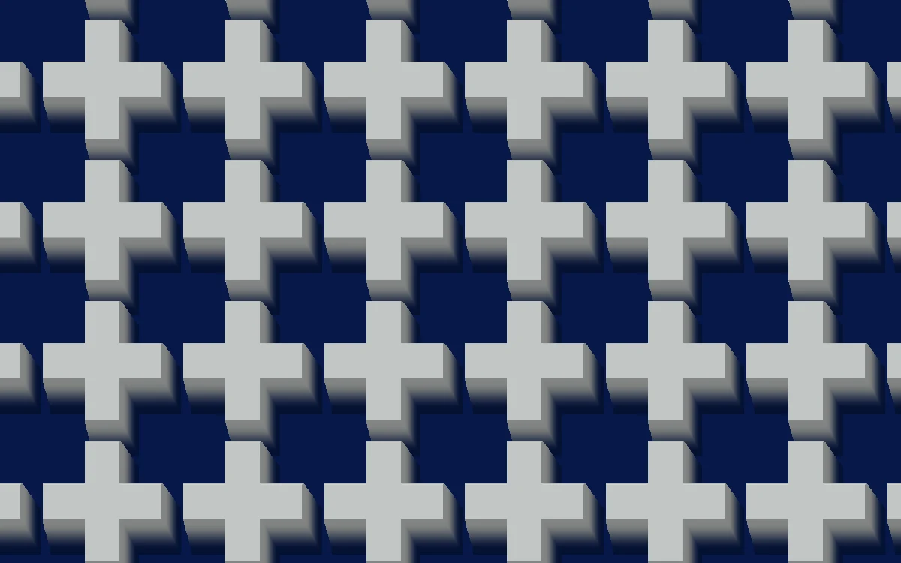

# Relief parallax

> Ivory crosses rise above deep blue recesses and occlude each other as the view shifts.

- **Common name:** Parallax relief shader
- **Category:** WebGL & shaders
- **Live demo:** https://www.subframe.com/motion/relief-parallax
- **Source:** Subframe (original, MIT)
- **Dependencies:** none

## Use case

Add perceived carved depth through view-dependent height traversal.

## Interaction

Adjust view angle.

## Look

Grid of pale ivory plus-shaped crosses raised over a deep navy ground, with soft grey shaded sides falling toward the lower right.

## Motion

The viewpoint drifts vertically on a slow 42 s sine and a view-angle slider swings it sideways, so the raised crosses shift over and occlude the recesses.

## How to adapt

The relief is the `FRAGMENT` shader: `heightAt` builds the cross heightfield, a 42-step loop marches it along `view`, and `u_control` sets horizontal tilt. Tune the `.23` depth scale; swap `heightAt` and the `col` colours for your own pattern.

## Reduced motion

The elapsed-time clock stops. Parameter controls immediately update the static composition.

## Limitations

Requires WebGL 1; a static CSS swatch appears if unavailable or after context loss. 42-step screen-space height traversal; no mesh geometry or arbitrary DOM refraction.

## Taxonomy

- **Components:** background
- **Triggers:** ambient
- **Techniques:** shader, parallax, 3d
- **Feel:** calm, refined
- **Contexts:** landing, editorial
- **Tags:** native webgl, parallax, occlusion, heightfield, relief, carved
- **Also known as:** parallax occlusion mapping, 3D relief pattern, embossed pattern background, heightmap depth shader, carved tile background
- **Surface color:** `#e5e8eb`

## Code

See [`component.tsx`](component.tsx).
