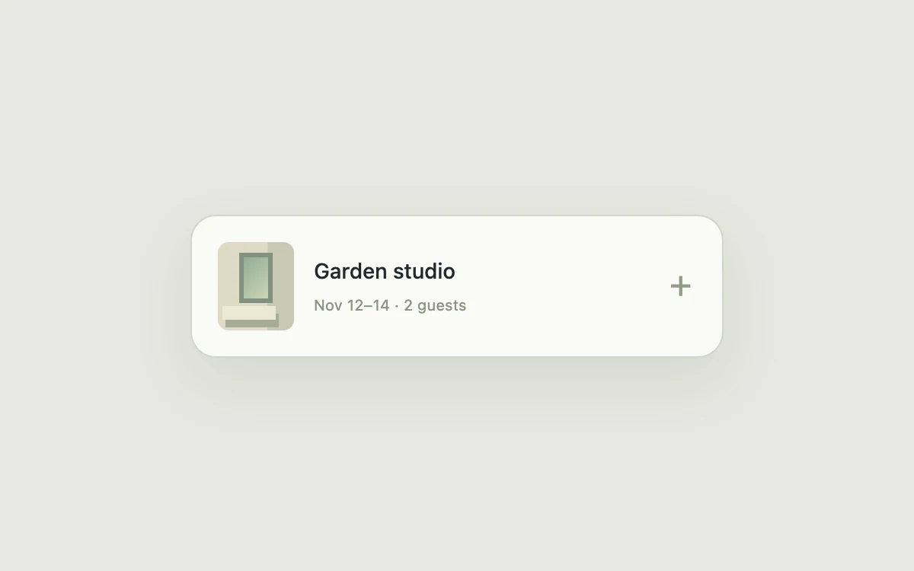

# Reservation disclosure

> Expand a compact reservation into editable details within the same visual anchor.

- **Common name:** Expandable booking card
- **Category:** Components & interactions
- **Live demo:** https://www.subframe.com/motion/reservation-dialog
- **Source:** Subframe (original, MIT)
- **Dependencies:** none

## Use case

Expand a compact reservation into editable details within the same visual anchor.

## Interaction

Open the reservation

## Look

Light sage-grey page with a single white rounded card: a small green-toned room illustration, dark title, muted date line and a sage plus icon.

## Motion

Clicking the card expands its booking details downward by animating grid rows from 0fr to 1fr over 260 ms ease-out while the plus rotates 45° into a close mark.

## How to adapt

Expansion is the `booking-details` `grid-template-rows` transition (260ms `cubic-bezier(0.2, 0.8, 0.2, 1)`) toggled by `open`, with `inert` disabling collapsed controls; `plus` rotates over 240ms. Replace the room summary, guest stepper and price with your content.

## Reduced motion

Live system preference disables decorative motion; all controls remain usable. Keyboard actions settle immediately.

## Limitations

Inline disclosure, not a modal or real booking service; no focus trap is needed because surrounding content stays interactive.

## Taxonomy

- **Components:** disclosure, card, form
- **Triggers:** press, keyboard
- **Techniques:** layout, rotate
- **Feel:** subtle
- **Contexts:** app
- **Tags:** reservation, disclosure, expand, booking
- **Also known as:** accordion card, inline expand details, collapsible summary card, grid rows height animation
- **Surface color:** `#edf0f3`

## Code

See [`component.tsx`](component.tsx).
