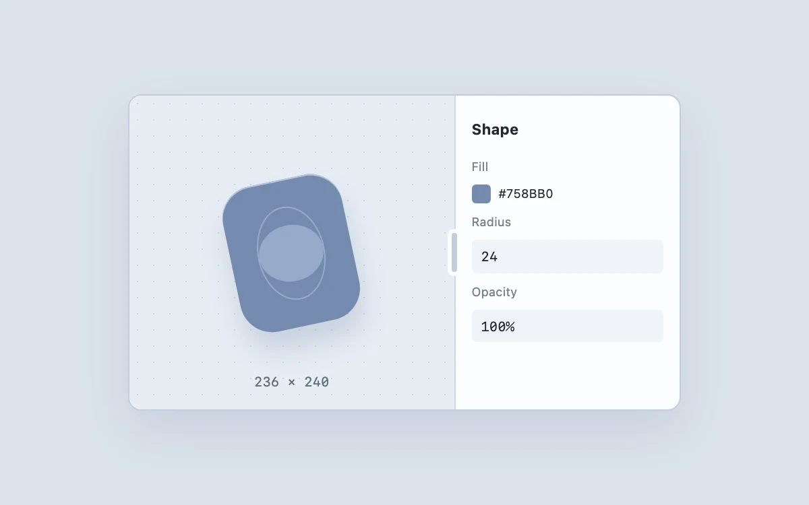

# Resizable inspector

> Resize an editing surface while its adjacent controls remain useful.

- **Common name:** Resizable split pane
- **Category:** Components & interactions
- **Live demo:** https://www.subframe.com/motion/resizable-inspector
- **Source:** Subframe (original, MIT)
- **Dependencies:** none

## Use case

Resize an editing surface while its adjacent controls remain useful.

## Interaction

Resize the inspector

## Look

Cool blue-grey page with a rounded editor window: dotted canvas with a tilted slate-blue shape, pill drag handle and a compact property inspector.

## Motion

Dragging the divider resizes the canvas 1:1 with the pointer, clamped to 38–72% of the width (arrow keys step 2%); the inspector flexes and the size readout updates.

## How to adapt

Resizing is the `update` function converting `clientX` into `split` (clamped 38–72) on the `.divider` separator, with pointer capture and arrow, Home and End keys. Replace the `.artboard` object and the `.inspector` fields with your panes.

## Reduced motion

Live system preference disables decorative motion; all controls remain usable. Keyboard actions settle immediately.

## Limitations

Canvas width is interactive; neighboring inspector values are static.

## Taxonomy

- **Components:** sheet, editor
- **Triggers:** drag, keyboard
- **Techniques:** layout
- **Feel:** technical, subtle
- **Contexts:** app
- **Tags:** resize, split pane, inspector, drag, editor
- **Also known as:** draggable divider, resizable panel, split view resize handle, adjustable sidebar width, pane splitter
- **Surface color:** `#edf0f3`

## Code

See [`component.tsx`](component.tsx).
