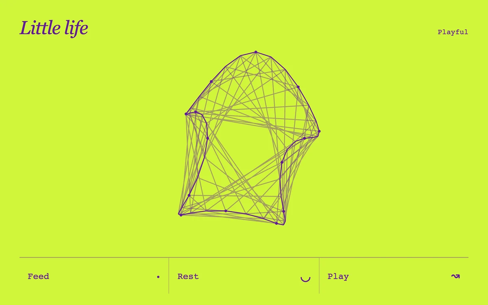

# Responsive creature

> A violet network changes shape as it is fed, played with, or put to rest.

- **Common name:** Reactive character animation
- **Category:** Animation & motion
- **Live demo:** https://www.subframe.com/motion/responsive-creature
- **Source:** Subframe (original, MIT)
- **Dependencies:** none

## Use case

A small character that communicates state through topology and cadence.

## Interaction

Feed, play, and switch between rest and wake.

## Look

Purple line-drawn network creature, a dotted outline with crossing chords, on a flat acid-lime field with an italic serif title and monospace buttons.

## Motion

The outline wobbles and breathes continuously; feeding swells it with six shrinking satellite dots, play speeds the wobble, and rest eases it into a plain oval as chords fade.

## How to adapt

`draw` builds the 42-point body from `state` (`time`, `sleep`, `food`, `play`), and `tick` eases `sleep` and decays `food` and `play` each frame. Tune the harmonic terms in `points` and the decay rates; replace the labels and palette.

## Reduced motion

Actions update a static state; breathing and connecting-line motion stop.

## Limitations

An illustrative character with finite responses, not a pet game or health model.

## Taxonomy

- **Components:** scene
- **Triggers:** press, ambient, state
- **Techniques:** canvas, morph
- **Feel:** playful
- **Contexts:** landing, app
- **Tags:** character, canvas, organism, network, state, topology, reactive
- **Also known as:** animated mascot, generative creature, virtual pet animation, living blob character, state-driven character
- **Surface color:** `#d1f63a`

## Code

See [`component.tsx`](component.tsx).
