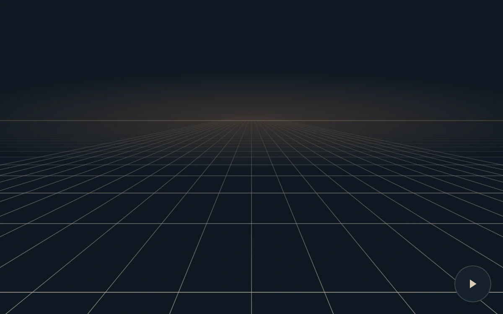

# A moving horizon

> A crisp perspective grid flows toward the viewer and fades before its lines compress at the horizon.

- **Common name:** Retro grid background
- **Category:** Animation & motion
- **Live demo:** https://www.subframe.com/motion/retro-grid
- **Source:** Magic UI (adapted, MIT) — https://magicui.design/docs/components/retro-grid · [original code](https://github.com/magicuidesign/magicui/blob/85f97fd27b053339af74ba9dd4ca428ee25989fb/apps/www/registry/magicui/retro-grid.tsx)
- **Dependencies:** none

## Use case

Create a legible graphic spatial backdrop for an event, launch or identity.

## Interaction

Play or pause the grid

## Look

Dark navy field with a thin warm-beige perspective grid receding to a horizon line beneath a faint amber glow; small round control button.

## Motion

Horizontal lines stream toward the viewer along a 1/distance projection in a seamless loop (about 1.6 s per row), fading in from the horizon; radial lines stay fixed.

## How to adapt

Motion is the `tick`/`draw` loop: `phase` advances `0.62` per second and each row's y is `136 + 340 / distance`, with opacity ramping up from the horizon. Tune row count, `stroke` colour, the `fade` mask and the `#c68d5e` glow.

## Reduced motion

The grid remains on a static projected frame; play control is hidden.

## Limitations

Finite SVG line projection; no camera,3D scene or WebGL dependency. Decorative backdrop rather than a navigation surface.

## Taxonomy

- **Components:** background
- **Triggers:** ambient
- **Techniques:** 3d, loop, fade
- **Feel:** calm, technical
- **Contexts:** landing
- **Tags:** grid, perspective, svg, retro, background, continuous, horizon
- **Also known as:** synthwave grid, perspective grid floor, 80s grid background, infinite grid horizon, moving floor grid
- **Surface color:** `#0e1822`

## Code

See [`component.tsx`](component.tsx).
