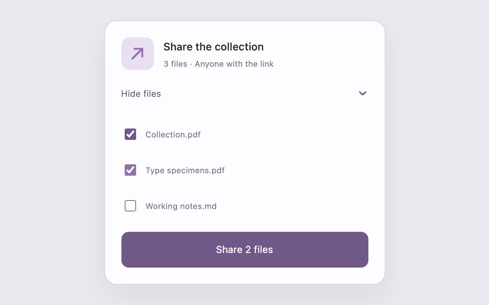

# Approval review

> Show exactly what an approval will include before confirming it.

- **Common name:** Approval confirmation dialog
- **Category:** Components & interactions
- **Live demo:** https://www.subframe.com/motion/review-disclosure
- **Source:** Subframe (original, MIT)
- **Dependencies:** none

## Use case

Show exactly what an approval will include before confirming it.

## Interaction

Choose which files to share

## Look

Pale lavender-grey page with a white rounded, softly shadowed card: lilac icon tile, small grey labels, purple checkboxes and a full-width muted purple button.

## Motion

Clicking the toggle expands the file list from zero height over 200 ms with an ease-out curve while its chevron rotates 90° in 180 ms; checkboxes update the button count.

## How to adapt

The expand is the `.review-files` grid switching `gridTemplateRows` between `0fr` and `1fr` (a 200 ms CSS transition); `inert` keeps hidden checkboxes unfocusable. Replace the file names, `checks` defaults and the `approve` button's action with a real share call.

## Reduced motion

Live system preference disables decorative motion; all controls remain usable. Keyboard actions settle immediately.

## Limitations

Prepares a local confirmation only; no files are shared and no public link is created.

## Taxonomy

- **Components:** disclosure, dialog
- **Triggers:** press, state
- **Techniques:** layout, rotate
- **Feel:** subtle
- **Contexts:** app
- **Tags:** approval, review, files, disclosure, confirmation
- **Also known as:** share confirmation, expandable file list, review before sharing, collapsible checklist
- **Surface color:** `#edf0f3`

## Code

See [`component.tsx`](component.tsx).
