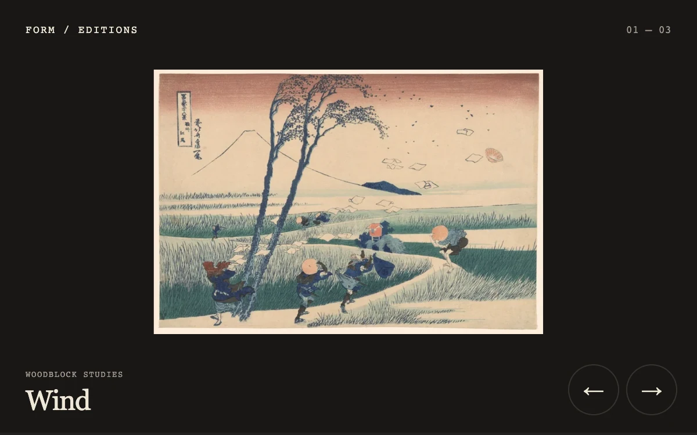

# Ribbon gallery

> A woodblock print separates into narrow, twisting ribbons before the next edition becomes whole.

- **Common name:** Ribbon image transition
- **Category:** WebGL & shaders
- **Live demo:** https://www.subframe.com/motion/ribbon-gallery
- **Source:** Subframe (original, MIT)
- **Dependencies:** none

## Use case

Give a finite art or image transition a dimensional material gesture while preserving a readable resting image.

## Interaction

Drag left across the print or select the next and previous controls.

## Look

Near-black gallery with a centred Japanese woodblock print, small spaced monospace labels, a cream serif title and two outlined circular arrow buttons.

## Motion

Arrows or a leftward drag split the print into 26 ribbons that ripple and twist in perspective as a wavy wipe reveals the next image, smoothstep-eased over 650 ms.

## How to adapt

Ribbon deformation is the `VERTEX` shader (amplitudes `.16` and `.38`, scaled by `envelope`) over 26 `bands`; `FRAGMENT` draws the wipe and `transition` runs the 650 ms smoothstep tween. Replace `PRINTS` with your images; drags past 0.12 progress complete.

## Reduced motion

Prints change instantly without ribbon deformation. Keyboard navigation is immediate.

## Limitations

Native WebGL 1 with a static image fallback if unsupported or context is lost. Supplied art images are CC0.

## Taxonomy

- **Components:** gallery, image
- **Triggers:** drag, press
- **Techniques:** shader, distortion, 3d
- **Feel:** refined, bold
- **Contexts:** editorial, landing
- **Tags:** gallery, ribbon, mesh, texture, webgl, vertex, deformation, art
- **Also known as:** WebGL image slider, image transition shader, distortion slideshow, twisting strips transition
- **Surface color:** `#181716`

## Assets

- [`suruga-wind.webp`](../../assets/suruga-wind.webp) — Wind-swept travelers beneath Mount Fuji (CC0-1.0)
- [`fuji-storm.webp`](../../assets/fuji-storm.webp) — Mount Fuji beneath a storm (CC0-1.0)
- [`plum-garden.webp`](../../assets/plum-garden.webp) — Flowering plum branch with a red sky (CC0-1.0)

## Code

See [`component.tsx`](component.tsx).
