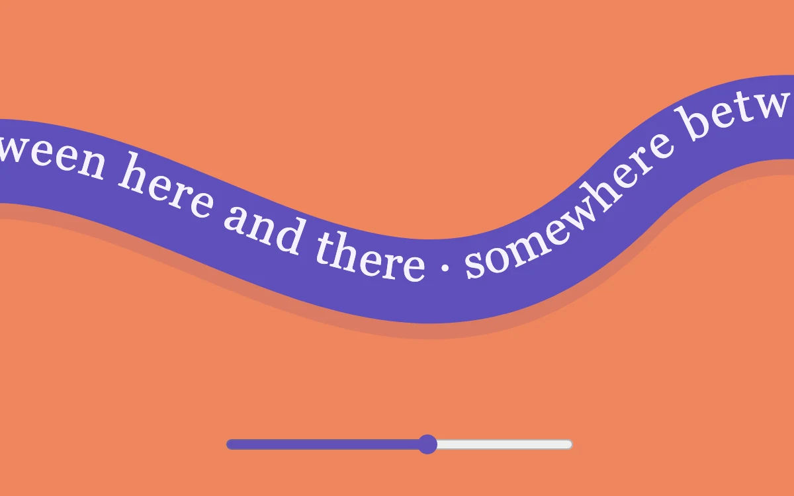

# Between the lines

> A curved ribbon of text can be dragged by hand or advanced with a range.

- **Common name:** Curved text marquee
- **Category:** Animation & motion
- **Live demo:** https://www.subframe.com/motion/ribbon-marquee
- **Source:** Subframe (original, MIT)
- **Dependencies:** none

## Use case

Create a distinctive, directly controllable typographic brand accent.

## Interaction

Drag or move the ribbon

## Look

Flat coral-orange field crossed by a thick wavy violet ribbon carrying white Georgia serif text, with a drop shadow and a violet range slider beneath.

## Motion

Dragging across the ribbon or moving the slider slides the text along the curved path one-to-one, clamped at both ends; it never scrolls on its own.

## How to adapt

Position is the `offset` state, applied as the `textPath` `startOffset` and clamped to `-300` to `60` in `onPointerMove` and the range input; the curve is the `path` in `defs`. Replace the repeated phrase, ribbon stroke colour and curve.

## Reduced motion

Live reduced-motion preferences remove interpolation and decorative playback. All content and native controls remain available. Keyboard changes settle immediately.

## Limitations

Original demonstration content; adapt labels and state to the host product.

## Taxonomy

- **Components:** text
- **Triggers:** drag
- **Techniques:** path, slide
- **Feel:** playful, bold
- **Contexts:** landing, editorial
- **Tags:** text path, curved, drag, ribbon, typography
- **Also known as:** text on a path, wavy text ribbon, draggable text banner, curved ticker
- **Surface color:** `#ef855d`

## Code

See [`component.tsx`](component.tsx).
