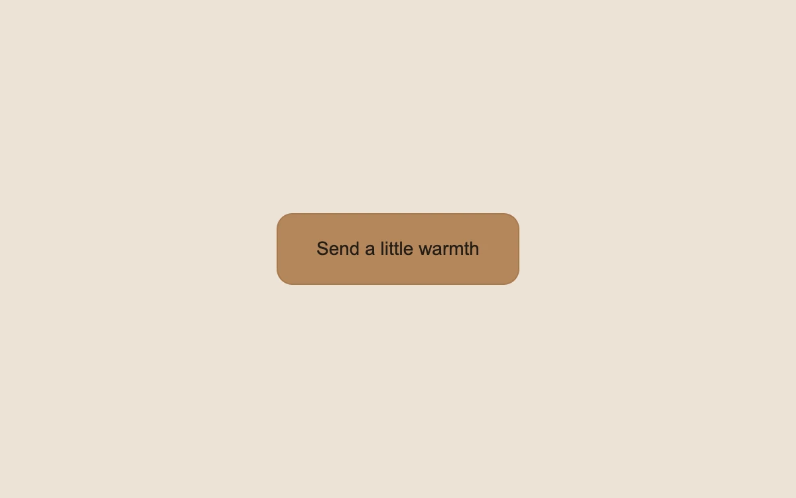

# A ripple on touch

> A soft circle expands from the exact point where the button is pressed.

- **Common name:** Ripple effect button
- **Category:** Components & interactions
- **Live demo:** https://www.subframe.com/motion/ripple-button
- **Source:** Magic UI (adapted, MIT) — https://magicui.design/docs/components/ripple-button · [original code](https://github.com/magicuidesign/magicui/blob/85f97fd27b053339af74ba9dd4ca428ee25989fb/apps/www/registry/magicui/ripple-button.tsx)
- **Dependencies:** none

## Use case

Provide visible confirmation on an occasional touch-friendly action.

## Interaction

Click at different points on the button

## Look

Warm beige page with a single centred caramel-brown rounded button with a darker border and dark sans-serif label.

## Motion

Each click spawns a pale circle at the pointer that scales from 0 to 2× while fading out over 650 ms ease-out; keyboard activation and reduced motion skip the ripple.

## How to adapt

`handleClick` sizes and positions each `Ripple` from the click point (keeping the last eight) and `onAnimationEnd` removes it; the `mg-button-ripple` keyframe sets scale and fade over 650ms. Replace the label, colours and the `count` demo action.

## Reduced motion

The click updates its text feedback without the expanding ripple.

## Limitations

The action only increments a local preview count. Ripples are bounded to eight and remove themselves when their animation ends.

## Taxonomy

- **Components:** button
- **Triggers:** press
- **Techniques:** scale, fade
- **Feel:** subtle
- **Contexts:** app
- **Tags:** button, click, touch, ripple, pointer origin, feedback
- **Also known as:** material ripple, click ripple, tap feedback circle, ink splash button
- **Surface color:** `#ece2d6`

## Code

See [`component.tsx`](component.tsx).
