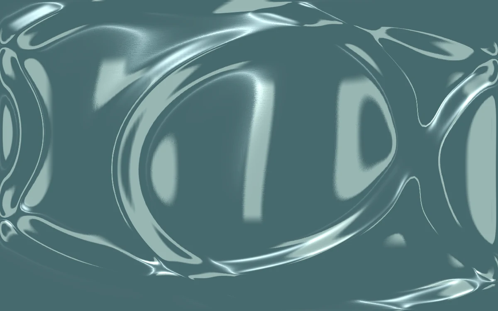

# Ripple memory

> A silver-green water surface remembers each disturbance as overlapping waves.

- **Common name:** Water ripple shader
- **Category:** WebGL & shaders
- **Live demo:** https://www.subframe.com/motion/ripple-memory
- **Source:** Subframe (original, MIT)
- **Dependencies:** none

## Use case

Add persistent, propagating ripple interaction to a procedural reflective surface.

## Interaction

Drag or press Enter on the water; adjust depth.

## Look

Muted slate-teal liquid surface with glossy silver-green highlights and warped reflected vertical bands, distorted by overlapping ripple rings.

## Motion

Pointer presses, drags and Enter add disturbances to a 128×128 CPU wave-equation height field whose ripples spread and slowly damp; an automatic drop lands every 2.4 s.

## How to adapt

Ripples come from `disturb` (Gaussian falloff 1200, amplitude 0.27) and `evolve`, a damped wave step (0.44 Laplacian, 0.996 decay) on the 128×128 `heights` grid uploaded as a texture; `FRAGMENT` shades it, `u_control` setting depth. Tune the 2.4 s auto-drop in `advance`.

## Reduced motion

The simulation clock stops. Deliberate pointer or keyboard disturbances update a static surface.

## Limitations

Requires WebGL 1; a static CSS swatch appears if unavailable or after context loss. A bounded 128×128 CPU height solver displayed with WebGL reflection; no arbitrary DOM refraction or GPU compute dependency.

## Taxonomy

- **Components:** background
- **Triggers:** drag, press, ambient
- **Techniques:** shader, physics, distortion
- **Feel:** calm, refined
- **Contexts:** landing, editorial
- **Tags:** native webgl, water, wave equation, persistent state, ripple, reflection, pointer
- **Also known as:** interactive water ripples, water surface simulation, liquid ripple background, pond ripple effect, wave simulation
- **Surface color:** `#668385`

## Code

See [`component.tsx`](component.tsx).
