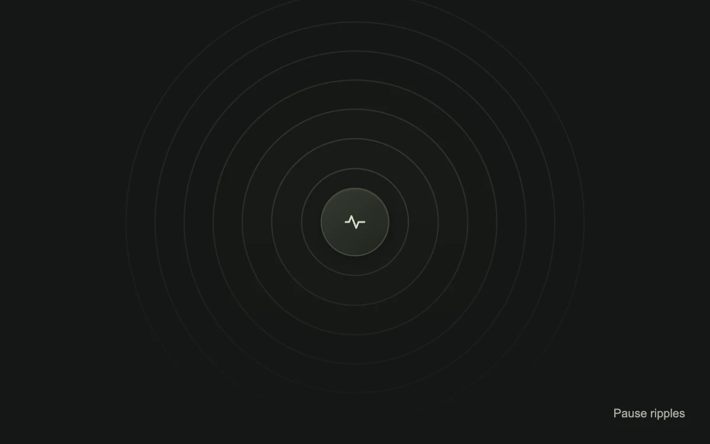

# Quiet ripples

> Concentric pulses give a simple focal point a sense of presence.

- **Common name:** Pulse ripple animation
- **Category:** Animation & motion
- **Live demo:** https://www.subframe.com/motion/ripple
- **Source:** Magic UI (adapted, MIT) — https://magicui.design/docs/components/ripple · [original code](https://github.com/magicuidesign/magicui/blob/85f97fd27b053339af74ba9dd4ca428ee25989fb/apps/www/registry/magicui/ripple.tsx)
- **Dependencies:** none

## Use case

Suggest discovery or connection in an illustration. Pair actual loading or connection status with text.

## Interaction

Play to watch the rings expand

## Look

Near-black olive-tinted field with seven faint concentric hairline rings fading toward the bottom around a small dark green-grey disc with a pulse-line icon.

## Motion

Seven concentric rings breathe in a continuous loop, each scaling to 1.075 and back over 3.5 s with ease-in-out, staggered outward by 0.13 s; a text button pauses them.

## How to adapt

The pulse is the `mg-quiet-ripple` keyframe (scale 1 to 1.075, 3.5 s ease-in-out) on each `mg-quiet-ring`; tune ring count, the `size` step, the 0.13 s `animationDelay` and per-ring opacity. Replace the centre disc's pulse-line SVG with your icon.

## Reduced motion

The rings remain on a representative static frame.

## Limitations

This is a decorative ambient pulse, not a click-position ripple or progress indicator.

## Taxonomy

- **Components:** background
- **Triggers:** ambient
- **Techniques:** scale, stagger, loop
- **Feel:** calm, subtle
- **Contexts:** landing, app
- **Tags:** ripple, pulse, CSS, loop, illustration
- **Also known as:** pulsing rings, radar pulse, sonar ripple background, concentric circles pulse, breathing rings
- **Surface color:** `#eceee9`

## Code

See [`component.tsx`](component.tsx).
