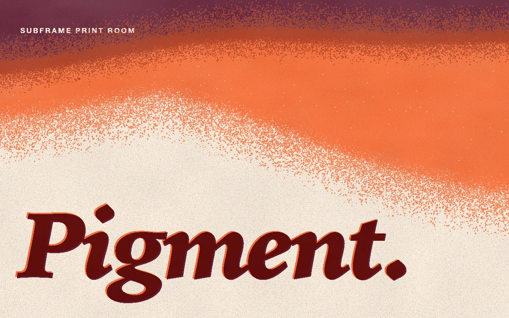

# Riso overprint

> Orange and burgundy inks drift through stochastic riso grain on warm uncoated paper and overprint into rust beneath a mark printed in both drums.

- **Common name:** Risograph grain shader
- **Category:** WebGL & shaders
- **Live demo:** https://www.subframe.com/motion/riso-overprint
- **Source:** Subframe (original, MIT)
- **Dependencies:** none

## Use case

A printed-feel backdrop for sections, covers and event identities. Ink 1–2 is the backdrop range, leaving a calm, mostly bare sheet for content; Ink 3 is the balanced default; Ink 4–5 prints a saturated cover.

## Interaction

Adjust ink density

## Look

Warm cream paper with a grainy burgundy veil along the top, an orange swell beneath, and a heavy burgundy italic serif wordmark lower left.

## Motion

The burgundy veil's edge and the orange swell undulate on slow layered sines, drifting their grainy boundaries; a five-step ink slider changes dot spread, density and dot gain.

## How to adapt

The print is the `FRAGMENT` shader: `veilEdge`, `orangeTone` and `burgundyTone` shape the drifting fields, `screen` builds the stochastic grain, and `u_ink` maps the slider. Change `PAPER`, `ORANGE`, `BURGUNDY` and `WORD`; `paintPlates` draws the mark and colophon into the plate texture.

## Reduced motion

Displays one stable, representative print. Live system preference changes stop the drift immediately; the Ink control still updates the still image.

## Limitations

Requires WebGL 1; a static CSS print with the same mark remains when WebGL is unavailable or lost. A stylized two-drum risograph, not a measured ink or paper profile; the drawing buffer is capped at 2 MP. The mark is set in local system serifs (Iowan Old Style Black Italic on Apple platforms, Georgia Bold Italic elsewhere), so letterforms vary by platform. The arithmetic grain hash assumes highp fragment precision and is untested on mobile GPUs.

## Taxonomy

- **Components:** background, text
- **Triggers:** ambient, state
- **Techniques:** shader, noise, gradient
- **Feel:** calm, refined
- **Contexts:** landing, editorial
- **Tags:** native webgl, riso, risograph, overprint, grain, stochastic screen, print, two-color, gradient, texture, background, typography
- **Also known as:** grainy gradient hero, two-colour print texture, overprint ink effect, stippled gradient background
- **Surface color:** `#f4ecdd`

## Code

See [`component.tsx`](component.tsx).
