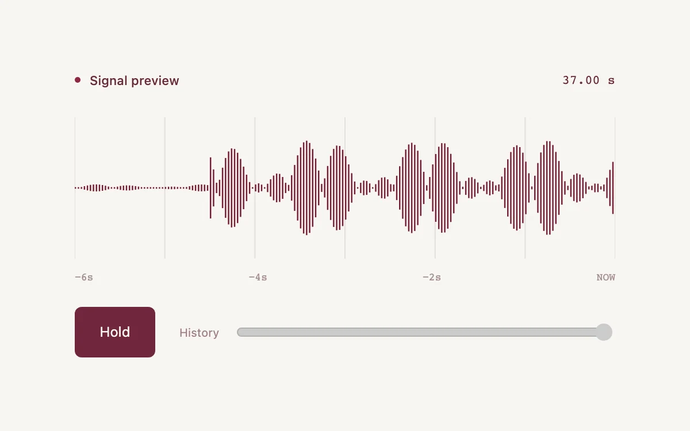

# Rolling signal

> A fine waveform retains recent signal history so it can be held and inspected.

- **Common name:** Scrolling signal waveform
- **Category:** Animation & motion
- **Live demo:** https://www.subframe.com/motion/rolling-signal
- **Source:** Subframe (original, MIT)
- **Dependencies:** none

## Use case

Inspect the recent history of a continuous signal.

## Interaction

Hold the signal, then scrub its retained history.

## Look

Warm off-white page with a fine maroon bar waveform over faint vertical gridlines, a monospace time axis, a solid maroon button and a grey slider.

## Motion

New samples arrive at 30 per second, scrolling the bar waveform leftward in steps; pressing hold freezes the stream so the history slider can scrub up to 650 samples back.

## How to adapt

`setInterval` at 30 Hz appends `sample` values to the 900-entry `history` buffer, and `draw` paints the last 180 (`count`) shifted by `offset`. Replace `sample` with a live feed and keep the `held` and reduced-motion gating.

## Reduced motion

The stream stops; the retained history remains inspectable.

## Limitations

A generated signal with 900 retained samples; no microphone or stored audio.

## Taxonomy

- **Components:** media, chart
- **Triggers:** ambient, press, drag
- **Techniques:** canvas, slide
- **Feel:** technical, subtle
- **Contexts:** dashboard, app
- **Tags:** waveform, history, signal, canvas, scrub, buffer
- **Also known as:** live waveform, streaming signal chart, oscilloscope view, real-time audio meter
- **Surface color:** `#f7f5f1`

## Code

See [`component.tsx`](component.tsx).
