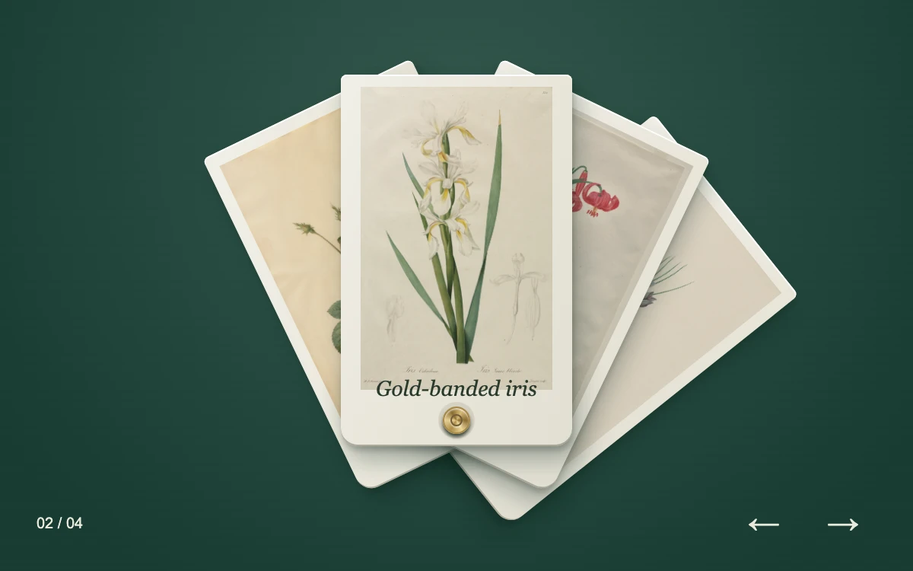

# Specimen fan

> Botanical plates fan around one brass binding, bringing the selected specimen upright for inspection.

- **Common name:** Fanned card carousel
- **Category:** Animation & motion
- **Live demo:** https://www.subframe.com/motion/rope-gallery
- **Source:** Subframe (original, MIT)
- **Dependencies:** none

## Use case

Give a small visual collection a tactile, direct-manipulation browsing surface.

## Interaction

Drag or select a specimen. Use the arrows, Left, Right, Home and End to browse.

## Look

Four cream paper cards bearing botanical illustrations fan from a brass rivet over a deep green gradient, with italic serif captions and minimal arrow controls.

## Motion

Cards rotate about a shared bottom pivot by distance from the selection; horizontal drag turns the fan directly, then a damped spring settles it on the nearest or clicked plate.

## How to adapt

The spring lives in `tick` (stiffness 210, damping 26), and `paint` rotates each `sf-plate` by `distance * spread` about the pivot; drag sensitivity is `dx / 95`. Replace `specimens` with your own images and titles; `choose` handles selection.

## Reduced motion

Selection changes are immediate; direct dragging remains available. Host pause freezes spring interpolation.

## Limitations

Four bounded specimen plates with a shared pivot; the cards stay bound and do not detach or open a lightbox.

## Taxonomy

- **Components:** gallery, card
- **Triggers:** drag, press, keyboard
- **Techniques:** rotate, spring
- **Feel:** refined, playful
- **Contexts:** editorial, landing
- **Tags:** carousel, specimen, fan, radial layout, shared pivot, physical paper, drag, spring, botanical
- **Also known as:** card fan slider, rotating card stack, swipeable card deck, radial image carousel
- **Surface color:** `#183b32`

## Assets

- [`botanical-cabbage-rose.webp`](../../assets/botanical-cabbage-rose.webp) — Cabbage Rose (Rosa Centifolia Simplex) (CC0-1.0)
- [`botanical-iris.webp`](../../assets/botanical-iris.webp) — Gold-banded Iris (CC0-1.0)
- [`botanical-turban-lily.webp`](../../assets/botanical-turban-lily.webp) — Lillium Pomponium (Turban Lily), plate 7 from Les Liliacées (CC0-1.0)
- [`botanical-crocus.webp`](../../assets/botanical-crocus.webp) — Les Liliacées:  Crocus Sativus (CC0-1.0)

## Code

See [`component.tsx`](component.tsx).
