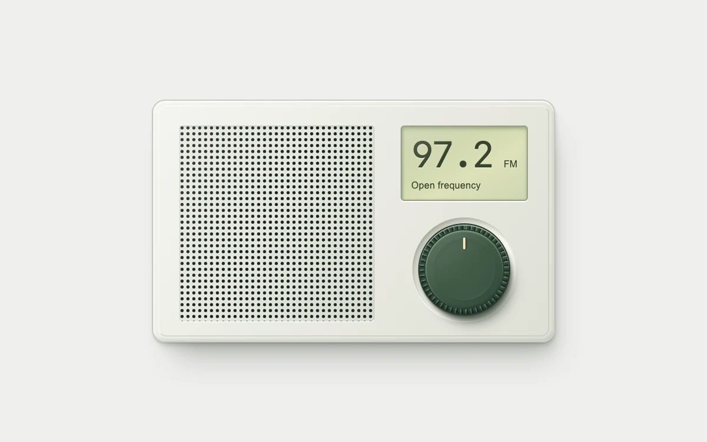

# Rotary tuner

> A detented olive dial tunes a recessed LCD inside a molded radio enclosure.

- **Common name:** Rotary knob dial
- **Category:** Components & interactions
- **Live demo:** https://www.subframe.com/motion/rotary-tuner
- **Source:** Subframe (original, MIT)
- **Dependencies:** none

## Use case

Station, preset, or channel selection in a compact player.

## Interaction

Rotate the rim, drag from the center, or use arrow keys

## Look

Light warm-grey page with a cream plastic radio: dotted speaker grille, pale green LCD readout in monospace digits, and a knurled dark-green knob.

## Motion

Dragging the knob rotates its pointer within ±120° (rim drags follow angle, centre drags follow horizontal movement); release snaps to the nearest of five 60° detents over 200 ms ease-out.

## How to adapt

Rotation lives in `onPointerMove` (`2.4` degrees per horizontal pixel, or angular from the rim) and `finish`, which snaps to `-120 + station * 60`; the settle is the 200 ms transition on `.sf-tuner-knob i`. Replace `stations` with your presets.

## Reduced motion

The knob settles immediately under reduced motion.

## Limitations

Local station presets; no network radio or audio stream.

## Taxonomy

- **Components:** slider, media
- **Triggers:** drag, keyboard
- **Techniques:** rotate
- **Feel:** refined
- **Contexts:** app
- **Tags:** radio, dial, rotary, detent, frequency, metal, device
- **Also known as:** skeuomorphic radio dial, detented knob, rotary selector, volume knob, channel tuner
- **Surface color:** `#efefec`

## Code

See [`component.tsx`](component.tsx).
