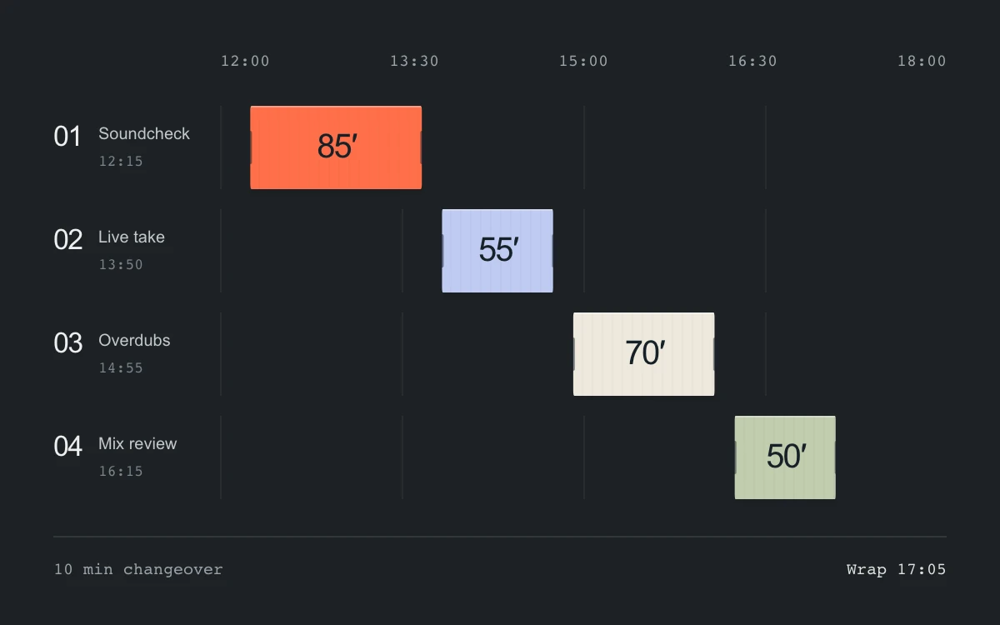

# Make room in the session

> Moving or resizing either end of a session shifts its neighbors in both directions while preserving minimum durations and changeover time.

- **Common name:** Ripple schedule resize
- **Category:** Components & interactions
- **Live demo:** https://www.subframe.com/motion/schedule-ripple
- **Source:** Subframe (original, MIT)
- **Dependencies:** none

## Use case

Edit a recording schedule or production timeline with collision handling and reversible ripple changes.

## Interaction

Drag a block to move it or either edge to resize. Focus a block or edge and use arrow keys in five-minute steps; Escape cancels the drag.

## Look

A charcoal recording timeline with numbered lanes, broad orange and cool-toned time blocks, large duration figures and subtle ruler marks.

## Motion

A block moves from its body or resizes from either end. Adjacent blocks translate in either direction; shrinking a committed expansion brings displaced neighbors back. Dashed ghosts show the pre-drag state; release commits and Escape restores the chain.

## How to adapt

`editSchedule` clamps movement and either resize boundary to packed neighbor bounds, then propagates collisions and connected gaps in both directions. Each drag reads a fixed snapshot. `fixture` supplies sessions; `DEFAULT_CONFIG` and the `config` prop configure count, changeover, closing time and transform settling.

## Reduced motion

Resizing the active block is immediate. Neighboring transform settling is disabled for keyboard input, reduced motion and inactive hosts. Pausing cancels the drag.

## Limitations

Local one-room schedule with five-minute steps and a fixed session order. Changes clamp to available space. Touching neighbors follow in either direction; free gaps absorb changes before distant blocks move. Changing count, gap or closing time resets the fixture.

## Taxonomy

- **Components:** editor, list, slider
- **Triggers:** drag, keyboard, state
- **Techniques:** slide, layout
- **Feel:** bold, technical
- **Contexts:** app, dashboard
- **Tags:** schedule, ripple, resize, timeline, booking, dependency, non-overlap, drag
- **Also known as:** ripple edit, schedule propagation, appointment resize, collision-free timeline, downstream reschedule
- **Surface color:** `#1d2226`

## Code

See [`component.tsx`](component.tsx).
