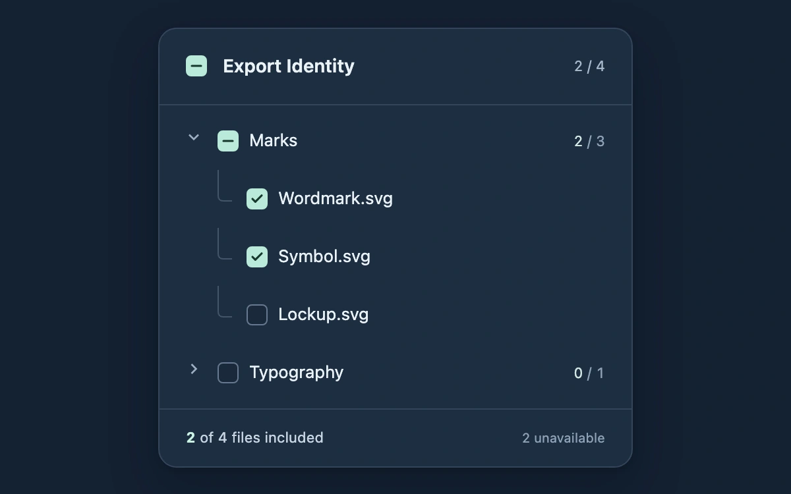

# Select a whole branch

> Folder checkboxes include eligible descendants while partial selections and unavailable files stay explicit.

- **Common name:** Tri-state file selection
- **Category:** Components & interactions
- **Live demo:** https://www.subframe.com/motion/scope-tree-selection
- **Source:** Subframe (original, MIT)
- **Dependencies:** none

## Use case

Choose a nested export scope without losing track of partially included folders.

## Interaction

Select a folder or file, expand Typography, and watch ancestor counts reconcile.

## Look

Ink-blue file panel with mint checks, narrow connector elbows, quiet branch counts and a persistent export tally.

## Motion

A pointer toggle settles the check mark over 140 ms; a partial mark resolves into a check while ancestor counts update immediately. Disclosure arrows rotate without delaying selection.

## How to adapt

The `fixture` function builds a bounded tree and `leafIds` derives descendants. `Selection` changes eligible IDs only. Tune the exported `DEFAULT_CONFIG` and the `config` prop; changing `depth` or `disabledLeaves` remounts the fixture.

## Reduced motion

Checkbox marks and disclosure arrows update immediately for keyboard input, reduced motion and inactive hosts. Inactive hosts disable every input.

## Limitations

Six local fixture files; selection does not create or download an archive. Folder-depth and unavailable-file configuration rebuild the fixture.

## Taxonomy

- **Components:** list, toggle, disclosure
- **Triggers:** press, keyboard, state
- **Techniques:** scale, fade, rotate
- **Feel:** subtle, technical
- **Contexts:** app, dashboard
- **Tags:** checkbox, tree, tri-state, indeterminate, selection, export, hierarchy, disabled
- **Also known as:** indeterminate checkbox tree, nested bulk selection, folder selection, select descendants
- **Surface color:** `#142132`

## Code

See [`component.tsx`](component.tsx).
