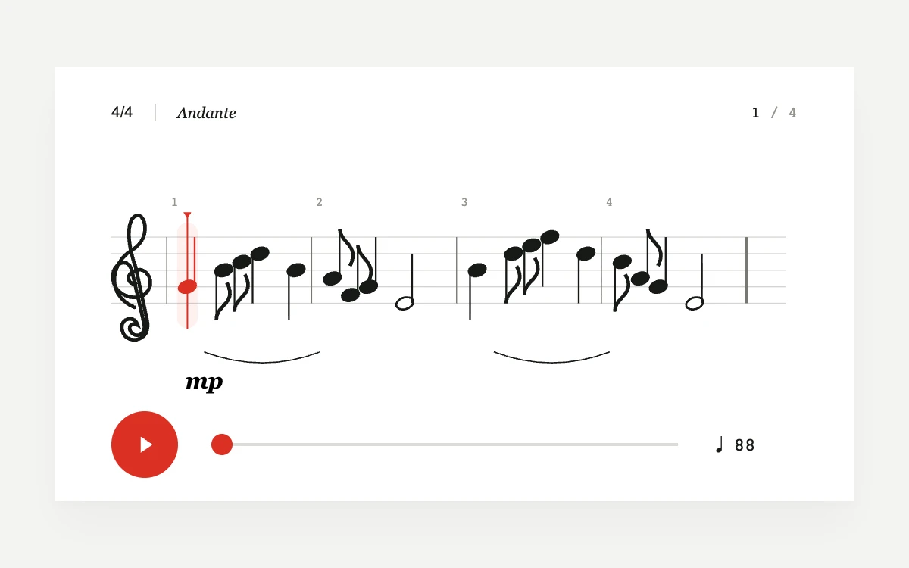

# Score follow

> A fine red playhead follows an original four-bar melody across a sharply engraved white score.

- **Common name:** Sheet music playhead
- **Category:** Animation & motion
- **Live demo:** https://www.subframe.com/motion/score-follow
- **Source:** Subframe (original, MIT)
- **Dependencies:** none

## Use case

Music practice, score previews, and notation synchronized with a controllable beat timeline.

## Interaction

Play, change the tempo, or drag the score to seek

## Look

Light grey page with a white sheet of crisp black engraved notation on a five-line staff, red playhead accents and a round red play button.

## Motion

Pressing play sweeps a thin red playhead linearly across four bars at the set tempo (88 BPM default), turning the current note red; dragging the score scrubs.

## How to adapt

Playback is the `requestAnimationFrame` `tick` advancing `cursor` by `tempo` beats per minute, mapped to x by `noteX`; the current note comes from `PHRASE` timing. Replace `PHRASE` (start beat, staff step, duration) and the 16-beat length with your own score.

## Reduced motion

The playhead advances between note positions instead of moving continuously. Playback starts only on request.

## Limitations

Silent visual notation with an original fixed melody; not a MusicXML parser, audio scheduler, or notation engraving engine.

## Taxonomy

- **Components:** media
- **Triggers:** press, drag
- **Techniques:** slide
- **Feel:** refined, technical
- **Contexts:** app, editorial
- **Tags:** music, notation, score, playhead, timeline, tempo, svg
- **Also known as:** music notation player, score cursor, sheet music follow along, note highlight playback
- **Surface color:** `#f4f4f1`

## Code

See [`component.tsx`](component.tsx).
