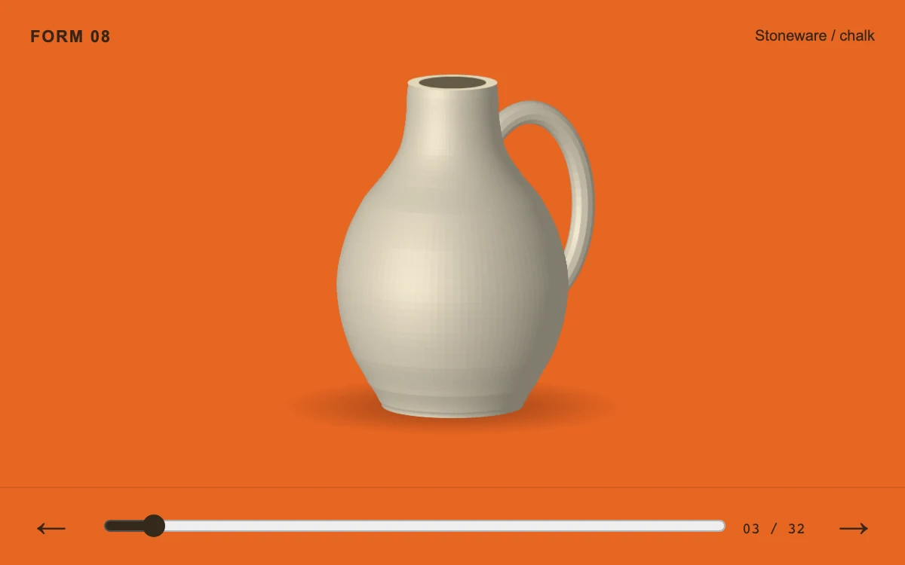

# Scroll turntable

> A glazed studio vessel turns through a cached sequence of thirty-two views on a vermilion plinth.

- **Common name:** Scroll 360 product viewer
- **Category:** Animation & motion
- **Live demo:** https://www.subframe.com/motion/scroll-turntable
- **Source:** Subframe (original, MIT)
- **Dependencies:** none

## Use case

Scrub an object sequence by scrolling while retaining direct frame selection.

## Interaction

Scroll through the object or select an individual view.

## Look

Vivid vermilion backdrop with a softly shaded cream stoneware jug and floor shadow, small dark captions, and a bottom bar with slider and arrows.

## Motion

Scrolling inside the panel maps progress to one of 32 views so the jug turns stepwise with no easing; the slider and arrows seek frames and sync the scroll.

## How to adapt

The `onScroll` handler maps `scrollTop` across the 800% `.st-track` to `frame` (0–31), and `seek` syncs it back; a sticky `.st-pinned` canvas shows each view, drawn on demand and cached in `frames` (eight kept). Replace the procedural vessel with your own frame images.

## Reduced motion

Scrolling and the frame slider select the requested cached view directly; there is no automatic playback.

## Limitations

The original vessel is drawn on demand and cached across 32 views at display density. It demonstrates indexed-frame playback, not a captured photographic sequence or a 3D model loader.

## Taxonomy

- **Components:** image, scene
- **Triggers:** scroll, drag, press
- **Techniques:** canvas, rotate, 3d
- **Feel:** refined
- **Contexts:** landing, editorial
- **Tags:** image sequence, scroll, frame scrub, canvas, product rotation
- **Also known as:** 360 spin on scroll, image sequence scrubber, product rotation viewer, frame scrub animation
- **Surface color:** `#e94c26`

## Code

See [`component.tsx`](component.tsx).
