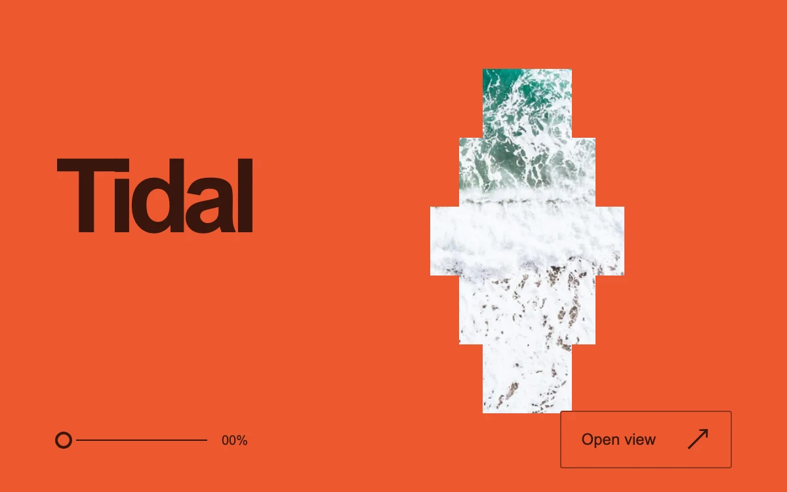

# Tidal aperture

> Five offset photographic windows widen and align into a single coastal panorama.

- **Common name:** Scroll-driven image reveal
- **Category:** Animation & motion
- **Live demo:** https://www.subframe.com/motion/scroll-window
- **Source:** Subframe (original, MIT)
- **Dependencies:** none

## Use case

Turn a small photographic fragment into a full image through a reversible reveal.

## Interaction

Scroll, drag upward, scrub the aperture slider or choose Open view.

## Look

Saturated vermilion field with a heavy dark-brown sans wordmark beside a stepped column of aerial surf photo slices; thin slider and outlined button below.

## Motion

Scroll, drag or slider progress reversibly widens five stacked clip-path bands, centre first with smoothstep easing, into one full-bleed photo while it zooms out and the title lifts and fades.

## How to adapt

Geometry lives in `draw`: each `.ta-window` gets a `clipPath` inset from `amount`, sized by `apertureWidth` and staggered by distance from the centre window; `.ta-track` height sets the scroll length. Replace the photo and `.ta-title` wordmark; `seek` routes the slider, drag and button.

## Reduced motion

Programmatic opening is immediate and image zoom is removed; direct scrolling and scrubbing remain available.

## Limitations

One local image and a bounded internal scroll area; no global scroll controller or video playback.

## Taxonomy

- **Components:** image
- **Triggers:** scroll, drag, press
- **Techniques:** mask, stagger, scale
- **Feel:** bold, refined
- **Contexts:** landing, editorial
- **Tags:** scroll, aperture, clip path, segmented reveal, photography, native scroll, range input, direct manipulation
- **Also known as:** scroll expand image, clip-path scroll reveal, sliced photo reveal, scroll scrubbed hero image, image strips align on scroll
- **Surface color:** `#ed592f`

## Assets

- [`blue-tide.webp`](../../assets/blue-tide.webp) — Aerial view photography of ocean (Unsplash)

## Code

See [`component.tsx`](component.tsx).
