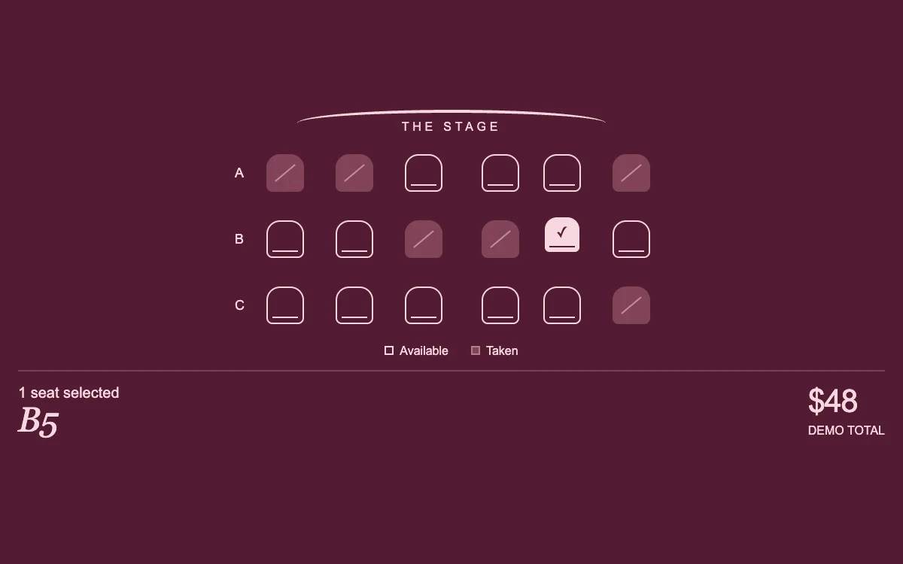

# An evening, together

> A small theatre plan answers every seat choice with a restrained lift and a live reservation total.

- **Common name:** Seat selection map
- **Category:** Components & interactions
- **Live demo:** https://www.subframe.com/motion/seat-picker
- **Source:** Subframe (original, MIT)
- **Dependencies:** none

## Use case

Make a small venue's availability and seat selection legible without burying the experience in checkout chrome.

## Interaction

Choose up to two available seats

## Look

Deep burgundy page with three rows of pale-pink outlined seat icons, muted slashed taken seats, a curved stage line and italic serif summary.

## Motion

Pressing a free seat fills it pale pink and lifts it 3 px (180 ms expo ease-out); hovering previews the lift, and the total updates, capped at two seats.

## How to adapt

The lift is pure CSS: `.sf-seats-shape` transitions `transform` and `background-color`, applied by `aria-pressed=true` and hover. `toggle` enforces the two-seat cap; replace `rows`, `unavailable` and the $48 price with real inventory.

## Reduced motion

Selection changes color and check state without lift. Keyboard selections also update immediately.

## Limitations

Local demonstration with fixed availability and a two-seat limit. Real booking requires server-side holds, live inventory, prices and checkout.

## Taxonomy

- **Components:** picker, form
- **Triggers:** press, hover
- **Techniques:** slide
- **Feel:** subtle, refined
- **Contexts:** app
- **Tags:** seat, theatre, reservation, booking, selection, availability, checkout, microinteraction, editorial, burgundy, serif
- **Also known as:** theatre seat map, seat booking selector, cinema seat chooser, ticket seat selection, venue seating chart
- **Surface color:** `#521b32`

## Code

See [`component.tsx`](component.tsx).
