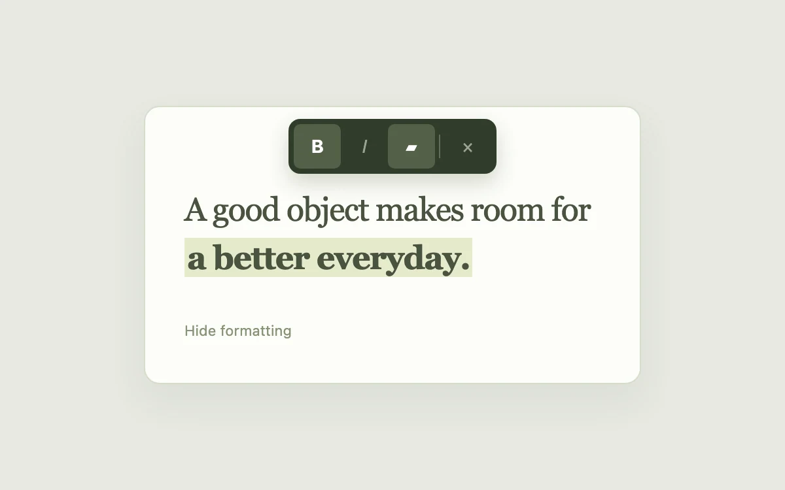

# Selection toolbar

> Keep formatting controls anchored to the words being edited.

- **Common name:** Text selection toolbar
- **Category:** Components & interactions
- **Live demo:** https://www.subframe.com/motion/selection-toolbar
- **Source:** Subframe (original, MIT)
- **Dependencies:** none

## Use case

Keep formatting controls anchored to the words being edited.

## Interaction

Format the selected phrase

## Look

Pale sage-grey page with a cream rounded card of large olive serif text, one phrase highlighted, and a dark olive floating toolbar above.

## Motion

Selecting text or pressing the format button fades the toolbar in while it rises 5 px and scales from 0.96 (180 ms ease-out); bold, italic and highlight toggle instantly.

## How to adapt

The toolbar is CSS on `.toolbar` keyed by `data-open` (fade plus `translate(-50%, 5px) scale(0.96)` to rest, 180ms ease-out), opened by the paragraph's `onMouseUp`. It sits at a fixed spot; anchor it to the selection range and replace the demo phrase.

## Reduced motion

Live system preference disables decorative motion; all controls remain usable. Keyboard actions settle immediately.

## Limitations

Formats one predefined phrase. Native text selection also opens the toolbar; this is not a full rich-text editor.

## Taxonomy

- **Components:** tooltip, text
- **Triggers:** press, state
- **Techniques:** fade, scale, slide
- **Feel:** subtle, refined
- **Contexts:** app, editorial
- **Tags:** toolbar, selection, text, formatting
- **Also known as:** floating formatting toolbar, bubble menu, rich text toolbar, highlight menu
- **Surface color:** `#edf0f3`

## Code

See [`component.tsx`](component.tsx).
