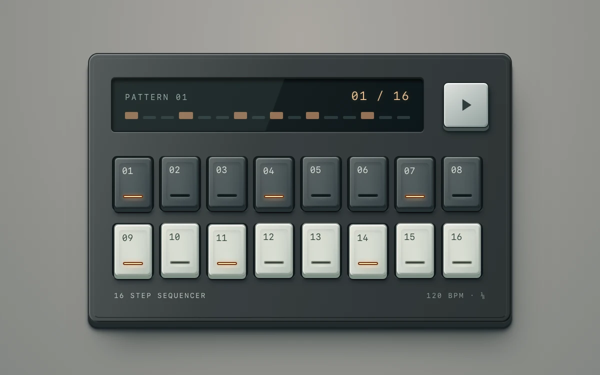

# Step sequencer

> Sixteen physical keys hold a pattern beneath a synchronized glass step display.

- **Common name:** Step sequencer
- **Category:** Components & interactions
- **Live demo:** https://www.subframe.com/motion/sequencer-grid
- **Source:** Subframe (original, MIT)
- **Dependencies:** none

## Use case

Author and inspect a short step pattern with separate enabled and current-step feedback.

## Interaction

Toggle keys and start or pause playback; reduced-motion playback advances one step at a time.

## Look

Skeuomorphic graphite hardware panel on warm grey with a dark glass display, pale play key, and rows of charcoal and cream keys with amber lights.

## Motion

Pressing a key latches it 1 px down and lights its amber strip; playback advances a glowing step marker across the sixteen keys and display every 250 ms, looping.

## How to adapt

Steps live in `steps` (from `initialPattern`) and `beat` advances in a 250 ms `setInterval`; key depth and lights are CSS on `sf-stepbank-face` and `sf-stepbank-light` via `aria-pressed` and `data-current`. Drive audio from `beat` and retune 250 for tempo.

## Reduced motion

Reduced motion uses a static playhead with an explicit Next step action.

## Limitations

Visual sequence only; no audio playback or synthesis. 

## Taxonomy

- **Components:** media, toggle
- **Triggers:** press, state, ambient
- **Techniques:** glow, loop
- **Feel:** technical, refined
- **Contexts:** app
- **Tags:** step sequencer, pattern, latching key, transport, tactile UI, playhead
- **Also known as:** drum machine grid, beat pattern editor, rhythm grid, skeuomorphic hardware keys
- **Surface color:** `#949590`

## Code

See [`component.tsx`](component.tsx).
