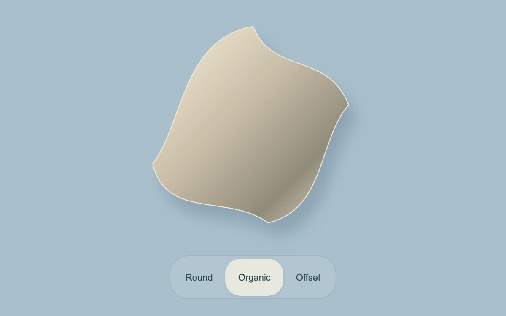

# Contour objects

> A rounded contour changes between three sculptural silhouettes.

- **Common name:** SVG shape morph
- **Category:** Animation & motion
- **Live demo:** https://www.subframe.com/motion/shape-morph
- **Source:** Subframe (original, MIT)
- **Dependencies:** none

## Use case

Explain related shapes, states or identity marks while preserving visual continuity.

## Interaction

Choose a contour

## Look

A soft beige-to-taupe gradient blob with a cream outline and drop shadow on a dusty blue background, above a translucent pill segmented control.

## Motion

Choosing a contour morphs the SVG outline to its path through a 700 ms CSS d transition (ease-in-out); keyboard selections snap instantly.

## How to adapt

The morph is `transition:d .7s` on `.sculpture path`, with each entry of `paths` applied as both the `d` attribute and a CSS `d` style. Replace `paths` with shapes sharing one command sequence (M, four C, Z) and recolour the gradient stops.

## Reduced motion

Live reduced-motion preferences remove interpolation and decorative playback. All content and native controls remain available. Keyboard changes settle immediately.

## Limitations

Path interpolation requires compatible command structure and browser support for CSS d. Unsupported interpolation still updates the SVG d attribute to the correct selected shape.

## Taxonomy

- **Components:** scene
- **Triggers:** press, state
- **Techniques:** morph
- **Feel:** refined, calm
- **Contexts:** landing, editorial
- **Tags:** SVG, morph, shape, interpolation, identity
- **Also known as:** blob morph, SVG path animation, organic shape transition, morphing logo shape, CSS d transition
- **Surface color:** `#a9bfcd`

## Code

See [`component.tsx`](component.tsx).
