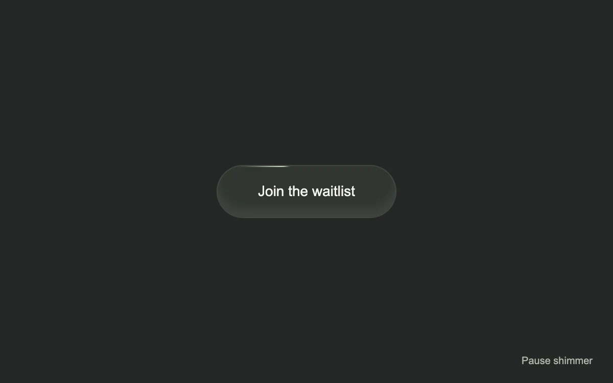

# Shimmer button

> A thin spark travels around a rounded button while the label stays still.

- **Common name:** Shimmer border button
- **Category:** Components & interactions
- **Live demo:** https://www.subframe.com/motion/shimmer-button
- **Source:** Magic UI (adapted, MIT) — https://magicui.design/docs/components/shimmer-button · [original code](https://github.com/magicuidesign/magicui/blob/85f97fd27b053339af74ba9dd4ca428ee25989fb/apps/www/registry/magicui/shimmer-button.tsx)
- **Dependencies:** none

## Use case

Give one occasional call to action a subtle idle highlight.

## Interaction

Click the button or pause the shimmer

## Look

Dark charcoal-green page with a single pill button in muted dark green, a soft inner highlight and a thin pale-green light on its edge.

## Motion

A blurred conic-gradient spark rotates once per 6 s with two holds while sliding across the button and back (3 s ease-in-out), lighting its 1 px edge.

## How to adapt

The light is `.mg-shimmer-light` (a 90deg conic wedge on `mg-shimmer-spin`) inside `.mg-shimmer-spark` (sliding on `mg-shimmer-slide`); `.mg-shimmer-backdrop` at `inset:1px` hides all but the rim. Recolour `#dbedc8`, tune durations, and wire the waitlist `onClick` to your handler.

## Reduced motion

The border holds still; the button continues to toggle its local saved state.

## Limitations

Uses CSS container query units. The waitlist action is local preview feedback; connect your own handler.

## Taxonomy

- **Components:** button
- **Triggers:** ambient, press
- **Techniques:** glow, gradient, loop
- **Feel:** subtle, refined
- **Contexts:** landing, app
- **Tags:** button, call to action, conic gradient, shimmer, idle loop, hover, click
- **Also known as:** shiny CTA button, animated gradient border button, spark outline button, glowing waitlist button
- **Surface color:** `#252826`

## Code

See [`component.tsx`](component.tsx).
