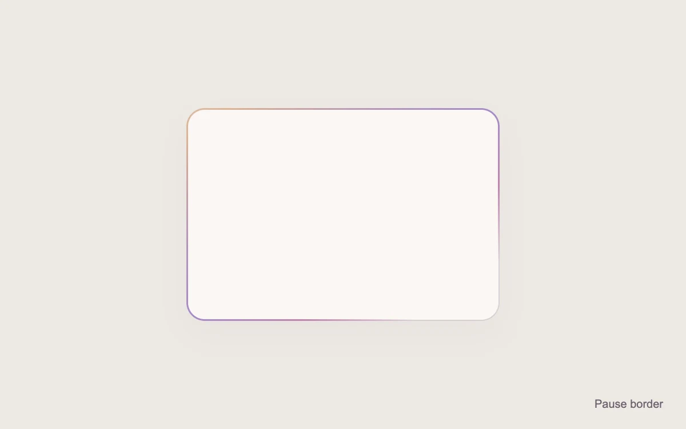

# Shifting border

> A softly colored gradient shifts around the edge of a quiet card.

- **Common name:** Animated gradient border
- **Category:** Animation & motion
- **Live demo:** https://www.subframe.com/motion/shine-border
- **Source:** Magic UI (adapted, MIT) — https://magicui.design/docs/components/shine-border · [original code](https://github.com/magicuidesign/magicui/blob/85f97fd27b053339af74ba9dd4ca428ee25989fb/apps/www/registry/magicui/shine-border.tsx)
- **Dependencies:** none

## Use case

Accent a featured card, release note or short editorial message.

## Interaction

Play or pause the border

## Look

Blank off-white rounded card on a warm greige page, its thin border tinted with soft peach, mauve and lavender that fades to grey.

## Motion

A 300% radial gradient masked to a 1.5 px border ring pans diagonally back and forth via background-position, completing an 8 s linear loop, so colour drifts around the edge.

## How to adapt

The effect is `.mg-shine-border`: a `radial-gradient` at `background-size:300% 300%`, clipped to its padding ring by `mask-composite:exclude` and animated by `@keyframes mg-shine-position` over `8s`. Change the gradient stops and `padding:1.5px` (border width); put content inside `.mg-shine-card`.

## Reduced motion

The border becomes a stationary gradient.

## Limitations

CSS mask-composite support is required for the border effect. Background-position animation repaints; keep the accent small.

## Taxonomy

- **Components:** card
- **Triggers:** ambient
- **Techniques:** gradient, mask, glow, loop
- **Feel:** subtle, refined
- **Contexts:** landing, app
- **Tags:** border, gradient, mask, ambient, card, idle loop
- **Also known as:** glowing card border, shimmering outline, moving border highlight, featured card accent, gradient stroke animation
- **Surface color:** `#eee9e4`

## Code

See [`component.tsx`](component.tsx).
