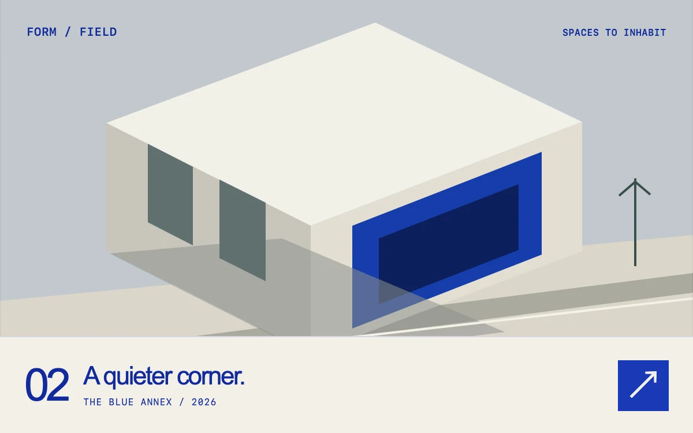

# A room for light

> Ultramarine shutters lift in sequence to reveal two architectural studies.

- **Common name:** Staggered shutter reveal
- **Category:** Animation & motion
- **Live demo:** https://www.subframe.com/motion/shutter-scene
- **Source:** Subframe (original, MIT)
- **Dependencies:** none

## Use case

Introduce a selected architectural project, an art direction study or a visual case study with a brief material reveal.

## Interaction

Reveal the next study

## Look

Isometric building illustration in stone, grey and cobalt above a cream caption bar with blue sans type, monospace labels and a square blue button.

## Motion

Clicking the arrow instantly covers the art with seven ultramarine panels that lift upward in a 45 ms stagger, 820 ms each with a strong ease-out, revealing the next study.

## How to adapt

The reveal is the `sf-shutters-open` keyframe (820 ms) on the `sf-shutters-blinds` panels, staggered by inline `animationDelay` (index × 45 ms) and replayed by remounting on `scene.sequence`. Replace `Architecture` and the captions; keep the `event.detail` check that skips it for keyboard.

## Reduced motion

The study and caption change immediately. Keyboard activation skips the shutter sequence.

## Limitations

The seven-panel reveal is decorative and does not hide interactive controls. Replace both original SVG illustrations with equally sized artwork when adapting.

## Taxonomy

- **Components:** image, gallery
- **Triggers:** press
- **Techniques:** stagger, scale, mask
- **Feel:** refined, bold
- **Contexts:** editorial, landing
- **Tags:** architecture, portfolio, shutter, reveal, stagger, mask, case study, SVG, CSS
- **Also known as:** venetian blind transition, blinds wipe reveal, slideshow shutter transition, portfolio project reveal, image curtain wipe
- **Surface color:** `#d9d7cd`

## Code

See [`component.tsx`](component.tsx).
