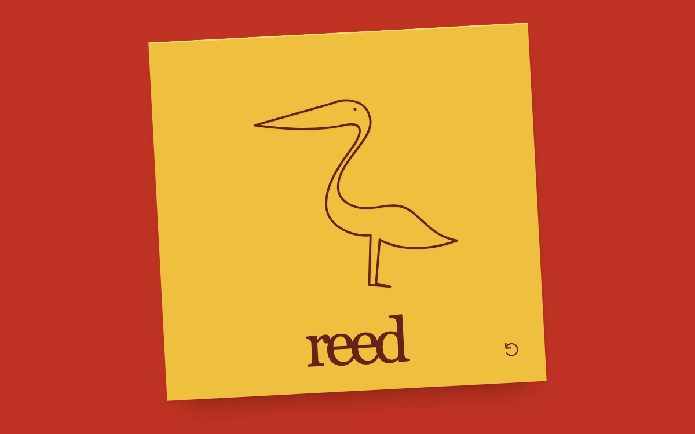

# Reed in one line

> A continuous heron emblem draws in oxblood ink across saffron stock, leaving a quiet printed impression underneath.

- **Common name:** SVG line drawing animation
- **Category:** Animation & motion
- **Live demo:** https://www.subframe.com/motion/signature-draw
- **Source:** Subframe (original, MIT)
- **Dependencies:** none

## Use case

Reveal an authored identity, illustration or sign-off through the order of its pen stroke.

## Interaction

Replay the emblem

## Look

Tilted saffron paper square on a vermilion-red field, with a fine oxblood single-line heron illustration, a faint offset impression and a large lowercase serif wordmark.

## Motion

The emblem starts complete; pressing replay redraws it as one stroke via stroke-dashoffset over 2.1 s ease-in-out, and the eye dot appears about a quarter through.

## How to adapt

Drawing is `@keyframes sd-heron-ink`, animating `stroke-dashoffset` from 100 on the `.sd-ink` path (`pathLength` 100), re-triggered by bumping `key={run}`. Swap `heron` for your path, keep `pathLength`, and tune `2100ms cubic-bezier(.37,.12,.28,1)`; replace the wordmark.

## Reduced motion

Replay shows the complete emblem immediately; host pause freezes an in-progress stroke and resumes from that position.

## Limitations

An independently authored stylized bird identity with a fixed path, not handwriting recognition, a captured human signature or a drawing input. The paper impression and shadows are authored CSS/SVG treatments.

## Taxonomy

- **Components:** scene
- **Triggers:** press
- **Techniques:** path
- **Feel:** refined, calm
- **Contexts:** landing, editorial
- **Tags:** stroke, drawing, signature, svg, ink, identity, logo, line-art, finite
- **Also known as:** logo draw animation, line art reveal, stroke dashoffset animation, handwritten signature reveal, one-line drawing
- **Surface color:** `#bf3324`

## Code

See [`component.tsx`](component.tsx).
