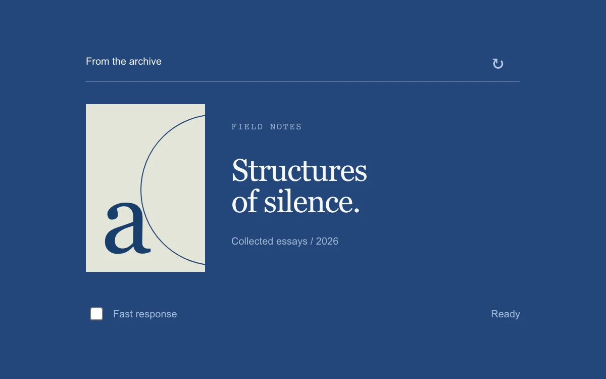

# Skeleton handoff

> A publication preview uses a delayed, shape-matched placeholder for slower responses.

- **Common name:** Skeleton loader
- **Category:** Components & interactions
- **Live demo:** https://www.subframe.com/motion/skeleton-handoff
- **Source:** Subframe (original, MIT)
- **Dependencies:** none

## Use case

Avoid placeholder flashes on fast responses while keeping slower content spatially predictable.

## Interaction

Reload the publication and compare fast and slow responses.

## Look

Deep blue page with a publication card: pale sage cover with a big serif letter and arc beside a white two-line serif title.

## Motion

Reloading waits 140 ms before cross-fading to shape-matched placeholder blocks, so the 65 ms fast response skips them; the 850 ms response fades new content in over 0.2 s.

## How to adapt

The handoff is two timers in the loading effect: `setSkeleton` after 140 ms and completion after 65 or 850 ms; `[data-skeleton=true]` swaps `.cover`/`.copy` for `.bones` by opacity. Replace the timers with your request lifecycle and reshape `bones` to your layout.

## Reduced motion

Placeholder and content swap instantly without fading; timing and layout remain stable.

## Limitations

Simulated local responses: 65 ms fast and 850 ms slow. The slow placeholder lasts 710 ms; this is not a general request cache or minimum-dwell abstraction.

## Taxonomy

- **Components:** progress, card
- **Triggers:** loading, press
- **Techniques:** fade
- **Feel:** subtle
- **Contexts:** app
- **Tags:** skeleton, loading, delayed-placeholder, crossfade, layout, async
- **Also known as:** skeleton screen, loading placeholder, content placeholder, delayed loading state, flash-free loading
- **Surface color:** `#24477b`

## Code

See [`component.tsx`](component.tsx).
