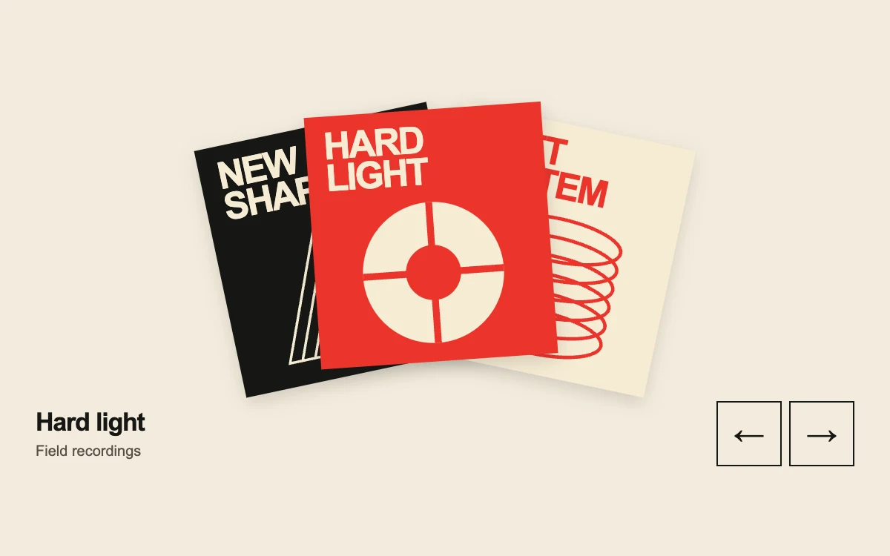

# Sounds with a shape

> Three graphic record sleeves rotate through a compact, tactile collection.

- **Common name:** Album cover carousel
- **Category:** Components & interactions
- **Live demo:** https://www.subframe.com/motion/sleeve-stack
- **Source:** Subframe (original, MIT)
- **Dependencies:** none

## Use case

Let a small music, print or editorial collection retain its physical character while making one item the focus.

## Interaction

Select a sleeve or browse with the arrow buttons

## Look

Cream page with three fanned square record sleeves in red, cream and black, tight bold sans titles and geometric line art, plus outlined arrow buttons.

## Motion

Selecting a sleeve or pressing an arrow swings the three cards between front, right and left fan slots with a 280 ms expo ease-out; hovering lifts a cover 5 px.

## How to adapt

Fan geometry is computed per card from `position` (`shift`, `angle`, `zIndex`) and animated by the `.sf-sleeves-card` transform transition (280 ms, `transform-origin:50% 130%`). Replace `records` and `SleeveArt` with your covers.

## Reduced motion

Selection changes directly with no interpolated rotation or hover lift. Keyboard activation also skips transitions.

## Limitations

A deliberately small three-item collection; use a list or grid for large inventories. The preview does not play music or navigate to product pages.

## Taxonomy

- **Components:** gallery, card
- **Triggers:** press, hover
- **Techniques:** rotate, slide
- **Feel:** refined, playful
- **Contexts:** editorial, landing
- **Tags:** record, vinyl, collection, stack, fan, cards, carousel, selection, editorial, graphic design, red, cream, SVG
- **Also known as:** fanned card stack, record sleeve carousel, rotating card deck, stacked cards selector, vinyl collection browser
- **Surface color:** `#f3ecdd`

## Code

See [`component.tsx`](component.tsx).
