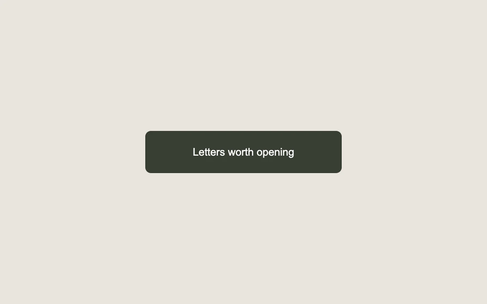

# A second line

> A second label rolls into view as you approach the action.

- **Common name:** Text roll hover button
- **Category:** Components & interactions
- **Live demo:** https://www.subframe.com/motion/slide-text-button
- **Source:** Kokonut UI (adapted, MIT) — https://kokonutui.com/docs/components/slide-text-button · [original code](https://github.com/kokonut-labs/kokonutui/blob/83eec6d982d400a18438001a8efdbac1f159dd43/components/kokonutui/slide-text-button.tsx)
- **Dependencies:** none

## Use case

Pair a short expressive call to action with a concrete label on an occasional marketing action.

## Interaction

Hover, then join the reading list

## Look

Warm greige page with one wide dark olive-green rounded button holding a single line of white sans-serif text.

## Motion

On fine-pointer hover the label track slides up 100% (300 ms ease-in-out) inside the clipped button, fading the first label out as a second label below fades in.

## How to adapt

The rollover is pure CSS: hover moves `.sf-slide-track` to `translateY(-100%)` over 300 ms `cubic-bezier(.645,.045,.355,1)` while the two `.sf-slide-face` layers swap opacity, gated by `(hover:hover) and (pointer:fine)`. Replace `text`, `hoverText` and the `subscribed` toggle.

## Reduced motion

The first label stays in place; the button still updates its subscribed state.

## Limitations

Hover text is a fine-pointer enhancement. The accessible action label remains clear on touch and keyboard.

## Taxonomy

- **Components:** button
- **Triggers:** hover
- **Techniques:** roll, slide, fade
- **Feel:** refined, subtle
- **Contexts:** landing
- **Tags:** button, hover, text, rollover, CSS, vertical slide, call to action
- **Also known as:** CTA hover, label swap button, sliding label hover, vertical text swap
- **Surface color:** `#e9e5dd`

## Code

See [`component.tsx`](component.tsx).
