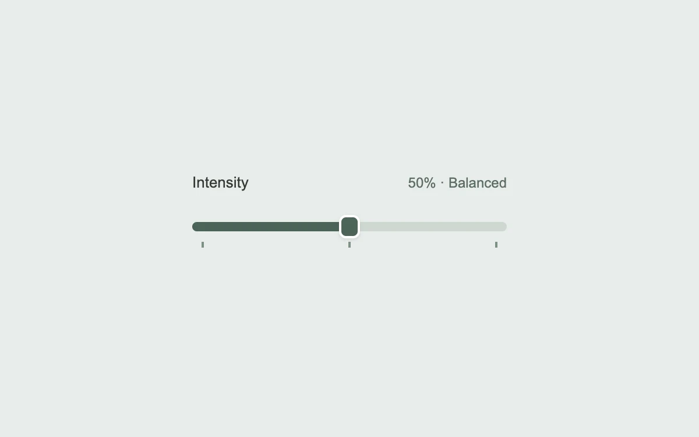

# A setting that settles

> A slider gently catches at meaningful settings and springs into position.

- **Common name:** Snapping range slider
- **Category:** Components & interactions
- **Live demo:** https://www.subframe.com/motion/slider-detents
- **Source:** Interior (adapted, MIT) — https://www.interior.dev/docs/slider-detents · [original code](https://github.com/ddoemonn/interior/blob/314800833bf01e23e6ae74c2a17fbdaac3688c84/components/interior/slider-detents.tsx)
- **Dependencies:** motion@12.0.5

## Use case

Give a continuous control a few useful stops without hiding the values in between.

## Interaction

Drag the slider; use arrow keys or Shift + arrows

## Look

Pale sage-grey page with a label and value readout above a slim dark-green filled track, white-ringed rounded-square thumb and three small tick marks.

## Motion

Dragging snaps to detents within 4.5% of the range; fill and thumb follow on a spring (stiffness 520, damping 34) and the held thumb grows to 1.08.

## How to adapt

`useSliderDetents` holds the snapping (`pull` defaults to 4.5% of range) and full keyboard map; the motion is `useSpring` with `CARRIAGE` feeding `x` via `useMotionTemplate`, plus the `GRAB` scale. Replace `DETENTS` with your stops and labels.

## Reduced motion

The thumb goes directly to each value without spring travel or scale. Keyboard changes are also immediate.

## Limitations

This is a single-thumb horizontal control. Review value labels and detent spacing when adapting its range.

## Taxonomy

- **Components:** slider
- **Triggers:** drag, keyboard
- **Techniques:** spring, scale
- **Feel:** subtle, refined
- **Contexts:** app
- **Tags:** slider, drag, detents, snap, spring, range, keyboard, settings
- **Also known as:** slider with snap points, magnetic slider stops, range slider tick marks, stepped slider, notched slider
- **Surface color:** `#e8eceb`

## Code

See [`component.tsx`](component.tsx).
