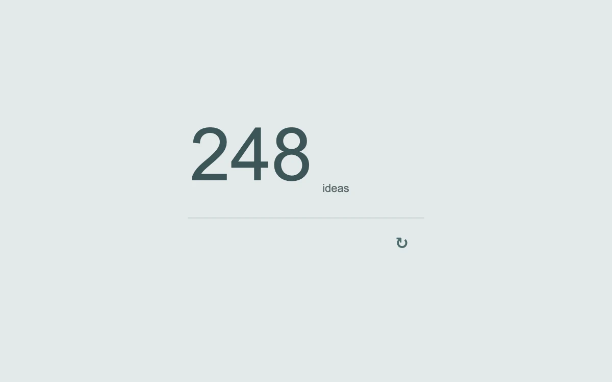

# Digits on a roll

> Individual digits take the shortest path around a spring-driven number wheel.

- **Common name:** Odometer digit counter
- **Category:** Components & interactions
- **Live demo:** https://www.subframe.com/motion/sliding-number
- **Source:** Motion Primitives (adapted, MIT) — https://motion-primitives.com/docs/sliding-number · [original code](https://github.com/ibelick/motion-primitives/blob/120f64f6ca60348e251f929e9c81f11ccbe45eda/components/core/sliding-number.tsx)
- **Dependencies:** motion@12.0.5

## Use case

Show occasional changes in a small metric, score or count.

## Interaction

Update the idea count

## Look

Large regular-weight slate-teal numerals with a small grey unit label on a pale blue-grey page, above a hairline rule and a small refresh icon.

## Motion

Pressing refresh changes the count and each digit column rolls vertically through intermediate numerals on a firm, non-bouncy spring (stiffness 280, damping 22, mass 0.3).

## How to adapt

`Digit` drives a `useSpring` (stiffness 280, damping 22, mass 0.3) per place and `NumberRow` wraps each numeral's `y` with `useTransform`; `canAnimate` falls back to `jump`. Replace `values` and the `[100, 10, 1]` place list for other digit counts.

## Reduced motion

Digits change immediately to their target. Only the target count is exposed to assistive technology.

## Limitations

This compact sample is a three-digit integer counter. Add explicit sign, decimal and digit-count handling for other data.

## Taxonomy

- **Components:** number
- **Triggers:** state, press
- **Techniques:** roll, spring
- **Feel:** subtle, refined
- **Contexts:** dashboard, app
- **Tags:** number, counter, odometer, digit, spring, metric, click, data
- **Also known as:** rolling number, animated counter, number ticker, slot machine digits, digit roller
- **Surface color:** `#e3e9e9`

## Code

See [`component.tsx`](component.tsx).
