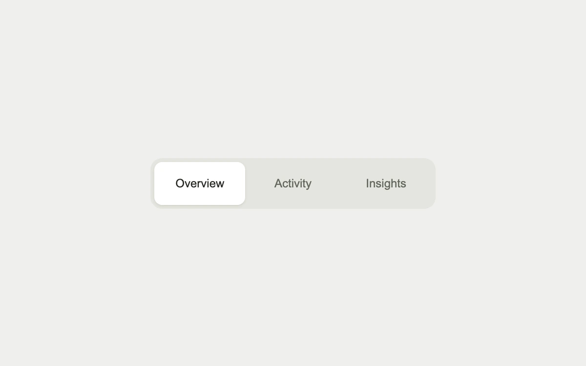

# Sliding selection

> A shared highlight keeps its momentum as you move between options.

- **Common name:** Sliding segmented control
- **Category:** Components & interactions
- **Live demo:** https://www.subframe.com/motion/sliding-tabs
- **Source:** Motion Primitives (adapted, MIT) — https://motion-primitives.com/docs/animated-background · [original code](https://github.com/ibelick/motion-primitives/blob/120f64f6ca60348e251f929e9c81f11ccbe45eda/components/core/animated-background.tsx)
- **Dependencies:** motion@12.0.5

## Use case

Make a view selection feel connected without moving labels or adding unrelated content.

## Interaction

Choose a different view

## Look

Light warm-grey page with a rounded grey track holding three sans-serif labels, the selected one on a white rounded pill with a faint shadow.

## Motion

Clicking a tab slides the white highlight to it with a fairly stiff spring (stiffness 460, damping 34) via a shared layout animation; keyboard selection jumps instantly.

## How to adapt

The highlight is a `motion.span` with `layoutId`, rendered only inside the selected tab; tune its spring in `transition`. Replace `views` and the visually hidden `tabpanel` with real panels, keeping `canAnimate` and the roving `onKeyDown` focus.

## Reduced motion

Keyboard selection and reduced-motion updates are immediate.

## Limitations

An isolated accessible selection example with a visually hidden current-view panel; connect selection to real product content when installing.

## Taxonomy

- **Components:** tabs
- **Triggers:** press, state
- **Techniques:** layout, spring, slide
- **Feel:** subtle
- **Contexts:** app, dashboard
- **Tags:** segmented control, layout, selection, spring, tabs
- **Also known as:** animated tab indicator, sliding pill tabs, shared layout tab highlight, tab switcher animation
- **Surface color:** `#efefec`

## Code

See [`component.tsx`](component.tsx).
