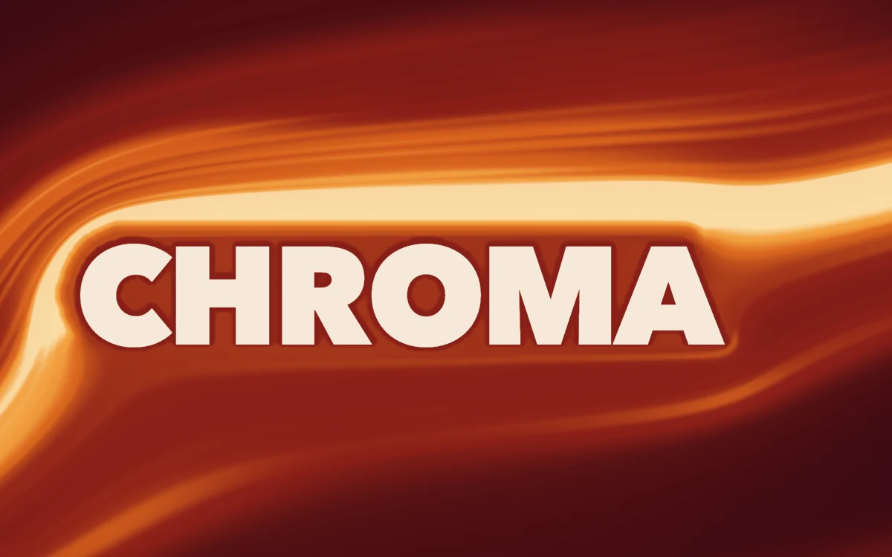

# Slipstream

> Amber and oxblood air flows around a live headline, wrapping its first letter and riding the cap line.

- **Common name:** Fluid hero text shader
- **Category:** WebGL & shaders
- **Live demo:** https://www.subframe.com/motion/slipstream
- **Source:** Subframe (original, MIT)
- **Dependencies:** none

## Use case

Launch pages, editorial covers and brand heroes where the headline itself shapes the backdrop and stays crisp, selectable text.

## Interaction

Adjust wind angle

## Look

Glowing orange, amber and deep red streaks flowing around a heavy cream sans-serif wordmark on a dark oxblood field.

## Motion

Amber streams flow around the wordmark at 0.12 stage heights per second, breathing on slow 24–30 s tides; a wind-angle slider (0–38°) re-steers them, stalling into a wake past 22°.

## How to adapt

The streams are the `FRAGMENT` shader sampling a potential-flow field that `solveFlow` and `steer` compute in an inline worker; tune `FLOW_SPEED`, `DEFAULT_ANGLE`, `STALL_ANGLE` and the `ramp` palette. Replace `MARK` (it must stay one text node); keep the reduced-motion and fallback branches.

## Reduced motion

A representative frame remains still and the pause control is hidden. Live system preference changes immediately stop the loop; the wind angle control still re-routes the still flow around the type.

## Limitations

Requires WebGL 1. A static CSS fallback appears when unavailable or after context loss, and the HTML headline stays in place. The mark must be a single text node; nested markup throws. It is set in system fonts (Avenir Next Heavy on macOS, Segoe UI on Windows, Noto Sans, Roboto or Arial elsewhere), so letterforms and the field shift slightly by platform. Potential flow around the rendered glyphs is solved in an inline worker whenever they change (resize or font load); a content security policy that blocks blob: workers moves that solve to the main thread. The stall wake is art-directed, not a fluid simulation. Wind angle 0 to 38 degrees; DPR at most 2 and at most 2.4 megapixels.

## Taxonomy

- **Components:** background, text
- **Triggers:** ambient
- **Techniques:** shader, gradient, distortion
- **Feel:** refined, calm
- **Contexts:** landing, editorial
- **Tags:** typography, airflow, headline, wordmark, potential flow, hero, background, native webgl
- **Also known as:** animated gradient hero, fluid text background, flowing gradient behind headline, airflow around text
- **Surface color:** `#24080d`

## Code

See [`component.tsx`](component.tsx).
