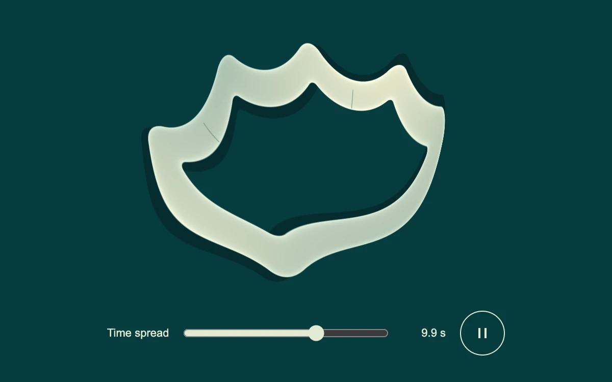

# Slit scan

> A porcelain frame stretches into an impossible ribbon as each image column samples a different instant.

- **Common name:** Slit-scan image shader
- **Category:** WebGL & shaders
- **Live demo:** https://www.subframe.com/motion/slit-scan
- **Source:** Subframe (original, MIT)
- **Dependencies:** none

## Use case

Create temporal distortion from a rigid animation while keeping the amount of time displacement explicit and controllable.

## Interaction

Change time spread or pause the scan.

## Look

Thick porcelain-white rounded frame smeared into a warped, scalloped ribbon with a dark drop shadow on deep teal; a slim slider row below.

## Motion

A square frame rotates and drifts continuously, each screen column rendering a different instant so it stretches into a ribbon; the Time spread slider sets offsets up to 15 s.

## How to adapt

In `fragment`, `sampleTime` adds `(uv.x-.5)*value*15.` to the clock, so `value` (slider / 100) sets the spread; the rigid pose (`angle`, offsets, `depth`) and the `box` frame are the subject to replace. Tune the `ceramic` and `background` colours; keep the context-loss handling.

## Reduced motion

The scene clock stops at a fixed pose. The time-spread control updates the static temporal composition directly.

## Limitations

Each column evaluates an analytic rigid pose at its own timestamp. It does not capture camera/video history or require feedback textures. Requires WebGL 1; static SVG artwork covers unsupported or lost contexts and automatically yields when restored.

## Taxonomy

- **Components:** background, scene
- **Triggers:** ambient
- **Techniques:** shader, distortion, rotate
- **Feel:** refined, calm
- **Contexts:** landing, editorial
- **Tags:** native webgl, slit scan, temporal sampling, time displacement, sculpture, loop
- **Also known as:** time displacement effect, temporal smear shader, time warp shader, stretched motion art
- **Surface color:** `#073c3e`

## Code

See [`component.tsx`](component.tsx).
