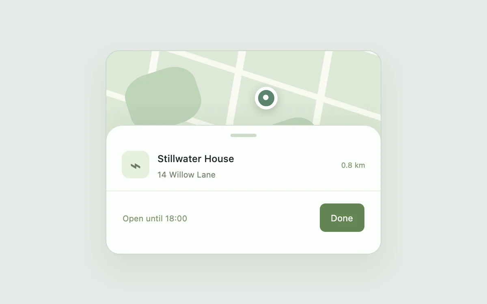

# Detent sheet

> Reveal more information with a sheet that settles at deliberate heights.

- **Common name:** Bottom sheet with snap points
- **Category:** Components & interactions
- **Live demo:** https://www.subframe.com/motion/snap-sheet
- **Source:** Subframe (original, MIT)
- **Dependencies:** none

## Use case

Reveal more information with a sheet that settles at deliberate heights.

## Interaction

Expand the location details

## Look

Rounded card: a pale sage map with cream roads and a pin, partly covered by a white bottom sheet with grab handle and green button.

## Motion

Dragging the handle tracks the pointer up to 74 px; releasing beyond 20 px, or tapping, snaps the sheet between two detents with a 280 ms ease-out transform transition.

## How to adapt

The collapsed offset is `74` px, used in the sheet's inline `translateY` and drag clamp; `onPointerUp` snaps past `20` px, easing via `transition: transform 280ms cubic-bezier(0.2, 0.8, 0.2, 1)` on `.sheet`. Replace `.map-art` and the location content.

## Reduced motion

Live system preference disables decorative motion; all controls remain usable. Keyboard actions settle immediately.

## Limitations

In-place location sheet with CSS map artwork; not a modal and no geographic data service.

## Taxonomy

- **Components:** sheet
- **Triggers:** drag, press
- **Techniques:** slide
- **Feel:** subtle
- **Contexts:** app
- **Tags:** drawer, sheet, detents, gesture, map
- **Also known as:** pull-up drawer, draggable bottom panel, map place card, swipe-up details sheet
- **Surface color:** `#edf0f3`

## Code

See [`component.tsx`](component.tsx).
