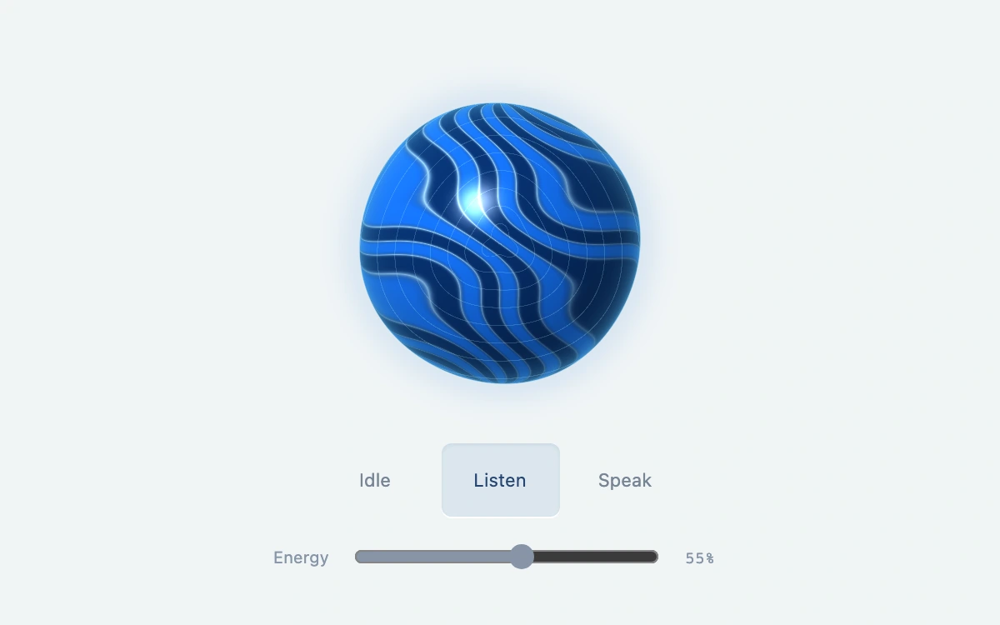

# Sonic orb

> A luminous blue membrane gathers fine contours while listening and emits expanding ripples while speaking.

- **Common name:** Voice assistant orb
- **Category:** WebGL & shaders
- **Live demo:** https://www.subframe.com/motion/sonic-orb
- **Source:** Subframe (original, MIT)
- **Dependencies:** none

## Use case

Distinguish voice-agent input and output states through the shape and direction of motion.

## Interaction

Select Idle, Listen or Speak, then adjust energy.

## Look

Pale blue-grey page with a glossy cobalt sphere banded by wavy navy contours inside a blue halo, above three state buttons and a slider.

## Motion

Contour bands drift continuously; listening adds faint inward rings and a slight edge wobble, speaking pulses the edge and emits outward ripples, with energy scaling both and states easing smoothly.

## How to adapt

All motion is in `FRAG`: `listening` and `speaking` weights derive from `uState`, `edge` sets the silhouette, `intake` the inward rings and `ripple` the outward waves. Drive `state` and `energy` from your real voice pipeline (e.g. mic level) instead of the buttons.

## Reduced motion

The shader clock stops. State and energy changes redraw immediately with distinct static silhouettes.

## Limitations

Manual state and energy preview; no microphone, transcription or real audio amplitude. Requires native WebGL.

## Taxonomy

- **Components:** media, scene
- **Triggers:** state, ambient
- **Techniques:** shader, morph, distortion
- **Feel:** refined
- **Contexts:** app, landing
- **Tags:** webgl, voice, avatar, orb, listening, speaking, membrane, shader, energy
- **Also known as:** AI voice orb, voice agent avatar, listening speaking indicator, assistant voice animation, voice activity sphere
- **Surface color:** `#f0f4f6`

## Code

See [`component.tsx`](component.tsx).
