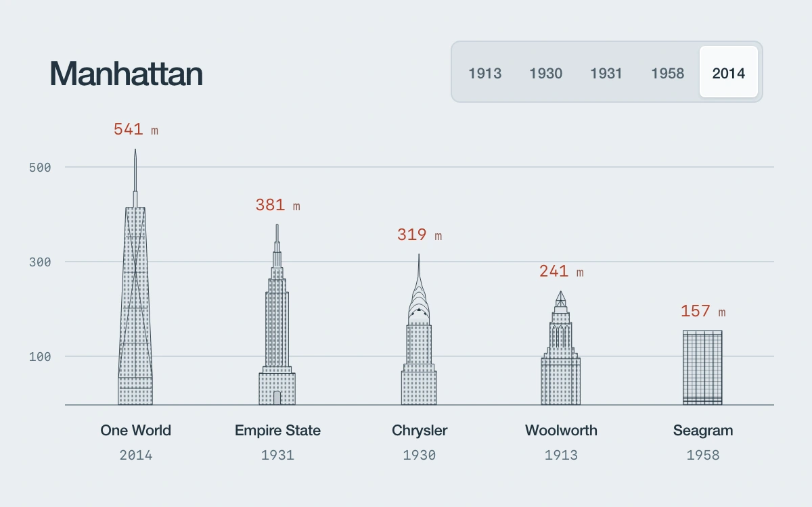

# Manhattan, rising

> Five landmark elevations grow from the baseline and change rank as dated skyline snapshots advance.

- **Common name:** Bar chart race
- **Category:** Animation & motion
- **Live demo:** https://www.subframe.com/motion/sort-choreography
- **Source:** Subframe (original, MIT)
- **Dependencies:** none

## Use case

Show how a ranked illustrated comparison evolves across meaningful historical states.

## Interaction

Choose a skyline year

## Look

Pale blue-grey page with five finely drawn skyscraper elevations as bars on a gridded baseline, rust monospace height labels above, and a segmented year control.

## Motion

Choosing a year re-sorts the towers by height in a 650 ms ease-out slide, scales newly built ones up from the baseline and collapses and fades unbuilt ones.

## How to adapt

`order` sorts `BUILDINGS` by `builtHeight` for the chosen `year`; each `.sf-sort-building` slides via inline `translateX`, `.sf-sort-elevation` grows with `scaleY`, all on `650ms cubic-bezier(.22,.8,.24,1)`. Replace `BUILDINGS`, `YEARS` and the `OUTLINES` drawings with your own series.

## Reduced motion

Buildings and rank positions update immediately for keyboard activation and reduced motion; pointer transitions grow from the baseline.

## Limitations

Five selected landmarks, not a complete Manhattan skyline or a construction-progress dataset. Rounded architectural heights; growth between snapshots is an illustrative transition, not measured construction speed.

## Taxonomy

- **Components:** chart, tabs
- **Triggers:** state, press
- **Techniques:** layout, scale, fade
- **Feel:** refined, technical
- **Contexts:** editorial, dashboard
- **Tags:** Manhattan, skyline, architecture, height, timeline, rank, growth, reorder, data visualization
- **Also known as:** animated ranking chart, reordering bar chart, height comparison chart, sorted bars transition, data story timeline
- **Surface color:** `#e9eef1`

## Code

See [`component.tsx`](component.tsx).
