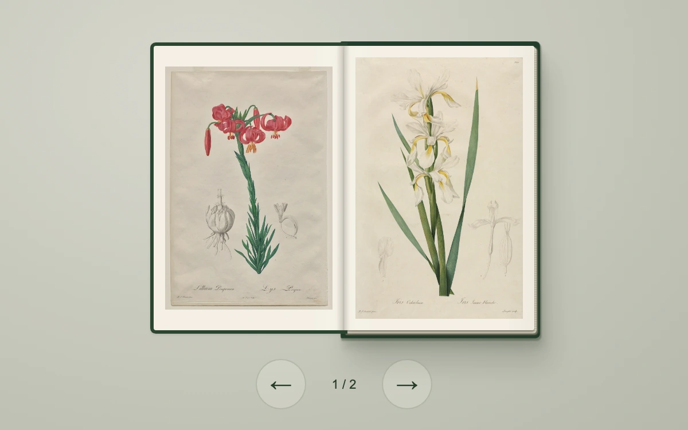

# Specimen book

> Four botanical engravings fill a clothbound volume with paired page faces, a shaded gutter and layered paper edges.

- **Common name:** 3D page turn book
- **Category:** Animation & motion
- **Live demo:** https://www.subframe.com/motion/specimen-book
- **Source:** Subframe (original, MIT)
- **Dependencies:** none

## Use case

Preview a small printed collection while preserving page order, image fidelity and the relationship between both faces of a leaf.

## Interaction

Turn the spreads, go back or close the cover.

## Look

Pale sage-grey backdrop with an open dark-green clothbound book showing two hand-coloured botanical engravings on cream paper, round translucent arrow buttons beneath.

## Motion

Arrow buttons swing a rigid leaf 180° around the spine in 3D over 640 ms ease-out; opening or closing also slides the book 83 px; keyboard turns are instant.

## How to adapt

Each `sb-leaf` turns by an inline `rotateY` with a 640 ms CSS transition; `turn` updates `leaf` and lifts the turning leaf's `zIndex` via `moving`. Replace `plates` and the cover artwork; keep `data-calm`, which disables transitions for reduced motion and keyboard.

## Reduced motion

Page and cover transforms settle immediately for reduced motion and keyboard actions. Host pause disables page controls and settles the current turn.

## Limitations

Two rigid turning leaves and a fixed final plate; not flexible paper simulation or a document renderer. The original interface uses separately licensed CC0 museum imagery.

## Taxonomy

- **Components:** gallery, scene
- **Triggers:** press
- **Techniques:** 3d, rotate, slide
- **Feel:** refined, calm
- **Contexts:** editorial, landing
- **Tags:** book, page turn, CSS 3D, paired leaves, botanical, editorial, publication, paper
- **Also known as:** page flip animation, flipbook viewer, book spread preview, digital catalogue
- **Surface color:** `#c 7c 9bc`

## Assets

- [`botanical-turban-lily.webp`](../../assets/botanical-turban-lily.webp) — Lillium Pomponium (Turban Lily), plate 7 from Les Liliacées (CC0-1.0)
- [`botanical-iris.webp`](../../assets/botanical-iris.webp) — Gold-banded Iris (CC0-1.0)
- [`botanical-crocus.webp`](../../assets/botanical-crocus.webp) — Les Liliacées:  Crocus Sativus (CC0-1.0)
- [`botanical-cabbage-rose.webp`](../../assets/botanical-cabbage-rose.webp) — Cabbage Rose (Rosa Centifolia Simplex) (CC0-1.0)

## Code

See [`component.tsx`](component.tsx).
