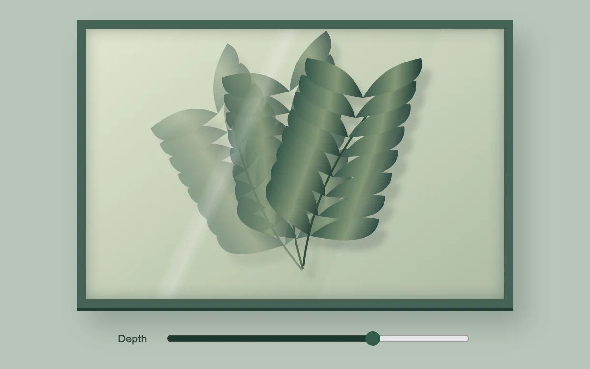

# Glasshouse

> Layered botanical silhouettes shift at different depths behind a glass pane.

- **Common name:** Mouse parallax layers
- **Category:** Animation & motion
- **Live demo:** https://www.subframe.com/motion/specimen-depth
- **Source:** Subframe (original, MIT)
- **Dependencies:** none

## Use case

Create a contained dimensional image for a botanical, architectural or material showcase.

## Interaction

Move across the specimen or adjust depth

## Look

Sage-green page with a deep green-framed glass case holding three overlapping translucent fern silhouettes, a diagonal glass glare and a depth slider below.

## Motion

Moving the mouse shifts three fern layers by increasing amounts toward the pointer with a 300 ms ease-out; leaving returns a rest pose, and the slider scales the depth.

## How to adapt

Mouse-only `onPointerMove` sets `point`; each fern `g` translates by `point` × `depth` scaled per layer, with a fixed rotation and 300 ms transition. Replace the three fern layers with your artwork; tune `depth` and the resting `point`.

## Reduced motion

Reduced motion disables pointer parallax. The depth range changes a meaningful static pose immediately for keyboard and touch users.

## Limitations

Original demonstration content; adapt labels and state to the host product.

## Taxonomy

- **Components:** image, scene
- **Triggers:** pointer, state
- **Techniques:** parallax
- **Feel:** calm, refined
- **Contexts:** editorial, landing
- **Tags:** parallax, depth, layers, botanical, pointer
- **Also known as:** pointer parallax, layered depth illustration, hover depth effect, multi-plane parallax, parallax frame
- **Surface color:** `#b9c5ba`

## Code

See [`component.tsx`](component.tsx).
