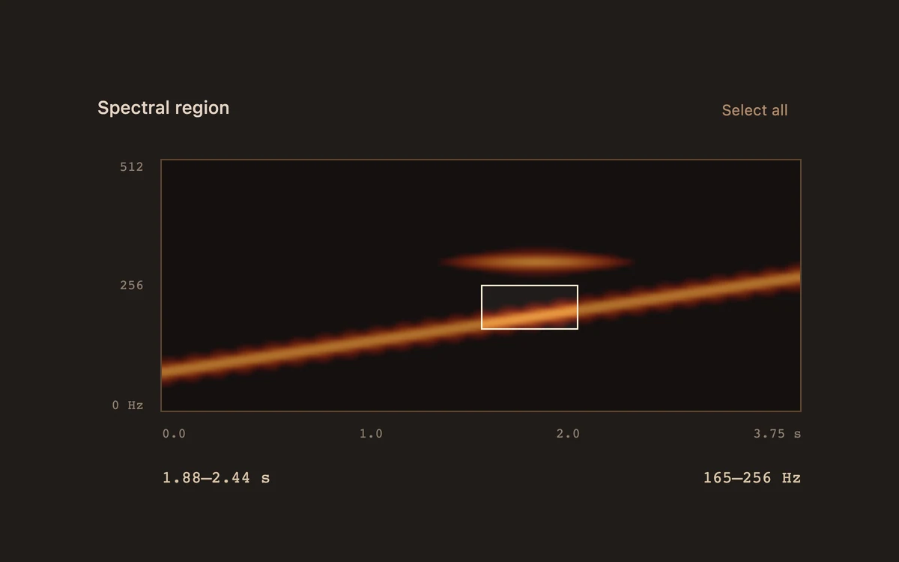

# Spectral selection

> A burnt-orange spectrogram reveals a swept tone and lets you isolate a time-and-frequency region.

- **Common name:** Spectrogram selection
- **Category:** Components & interactions
- **Live demo:** https://www.subframe.com/motion/spectral-selection
- **Source:** Subframe (original, MIT)
- **Dependencies:** none

## Use case

Select a sound feature occupying only a time/frequency region.

## Interaction

Drag a region, move it with arrow keys, or resize it with Shift and arrows.

## Look

Dark espresso-brown panel with a burnt-orange spectrogram heatmap showing a rising diagonal chirp, a thin cream selection box and monospace axis labels.

## Motion

Dragging across the spectrogram draws a cream rectangle that follows the pointer directly, dimming the outside and updating time and frequency readouts; arrows nudge it, Shift-arrows resize.

## How to adapt

`spectrum` computes a Hann-windowed DFT of a synthetic chirp once and paints it to the canvas; the selection is normalised `box` state set by `onPointerMove` and `keyboard`. Replace `spectrum` with your STFT data and adjust the 3.75 s and 512 Hz readout scales.

## Reduced motion

Selection follows direct input without ambient or eased motion.

## Limitations

Bounded Hann-windowed DFT of original synthesized samples. Selection is visual; no audio editing, playback or export.

## Taxonomy

- **Components:** media, editor
- **Triggers:** drag, keyboard
- **Techniques:** canvas
- **Feel:** technical
- **Contexts:** app
- **Tags:** spectrogram, fft, selection, frequency, time, canvas
- **Also known as:** spectrogram marquee select, rubber band region select, audio spectral editor, frequency band selection
- **Surface color:** `#211c19`

## Code

See [`component.tsx`](component.tsx).
