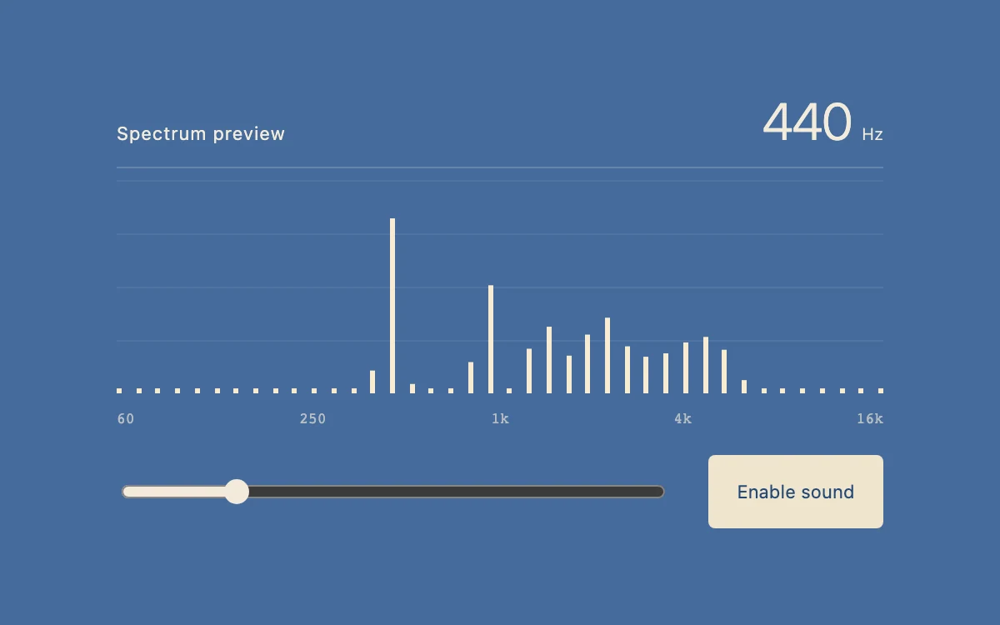

# Spectrum stack

> Fine logarithmic frequency bands reveal the harmonics of an adjustable synthesized tone.

- **Common name:** Audio spectrum analyzer
- **Category:** Components & interactions
- **Live demo:** https://www.subframe.com/motion/spectrum-stack
- **Source:** Subframe (original, MIT)
- **Dependencies:** none

## Use case

Show where energy is concentrated; make a filter adjustment legible.

## Interaction

Enable sound and change oscillator frequency.

## Look

Muted steel-blue panel with forty thin cream vertical bars on a faint grid, a large light-weight frequency readout, log-scale labels, a slider and cream button.

## Motion

With sound enabled, 40 log-spaced bars scale to AnalyserNode levels sampled every 33 ms with 70 ms linear transitions; before that, the slider redraws an analytical harmonic preview.

## How to adapt

`toggle` routes a sawtooth `OscillatorNode` through an `AnalyserNode` (`fftSize` 2048); a `setInterval` effect maps bins to 40 log bands in `levels`, and `previewBands` draws the idle state. Swap the oscillator for a media or microphone source; keep `stop` and `closeContext`.

## Reduced motion

Bars update without interpolated motion at four samples per second; sound remains opt-in.

## Limitations

Uses a native oscillator and AnalyserNode. Idle bands are an analytical preview, not live microphone data.

## Taxonomy

- **Components:** media, chart
- **Triggers:** state, press
- **Techniques:** scale
- **Feel:** technical
- **Contexts:** app
- **Tags:** audio, fft, spectrum, frequency, analyser, synthesizer
- **Also known as:** audio visualizer, equalizer bars, FFT frequency bars, sound frequency meter
- **Surface color:** `#456c9c`

## Code

See [`component.tsx`](component.tsx).
