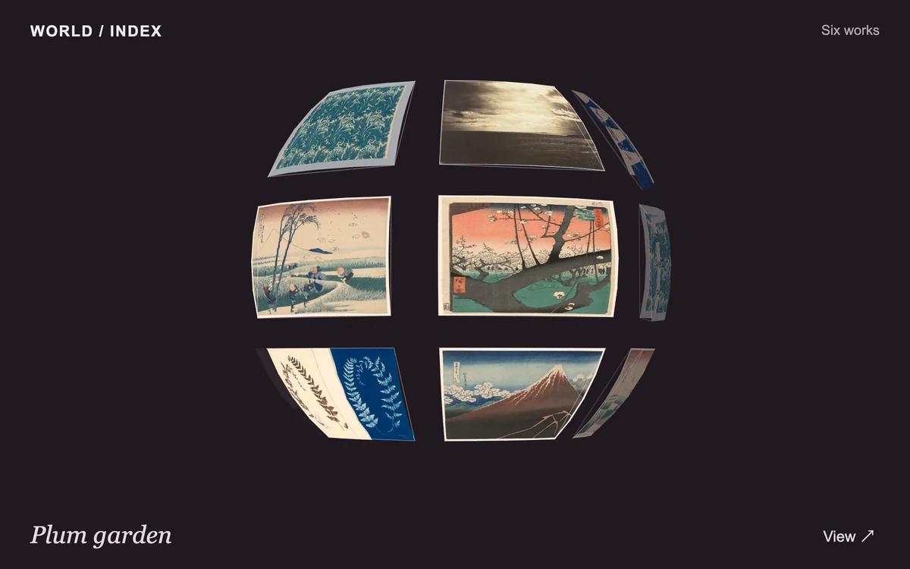

# Sphere index

> An image collection wraps over a dark spherical surface, then unfolds one selected work into a flat plate.

- **Common name:** Spherical image gallery
- **Category:** Animation & motion
- **Live demo:** https://www.subframe.com/motion/sphere-index
- **Source:** Subframe (original, MIT)
- **Dependencies:** none

## Use case

Explore a compact image index spatially while keeping a readable inspection state.

## Interaction

Orbit the sphere and open a work.

## Look

Near-black plum background with woodblock prints and botanical images warped into curved tiles on a sphere, small uppercase header and italic serif caption.

## Motion

Dragging or arrow keys orbit the tiled sphere directly; opening a tile exponentially eases its mesh from curved to a flat centred plate while the other tiles fade out.

## How to adapt

One canvas effect does everything: `point` projects longitude and latitude with `yaw` and `pitch`, `triangle` affine-maps image triangles, and `tick` eases `amount` toward `target` (75 ms time constant) to flatten. Replace `works`; `tiles` sets the 18-tile layout.

## Reduced motion

Orbit controls respond directly and selected images flatten immediately.

## Limitations

Six unique works repeat across eighteen tessellated tiles. Canvas 2D projection approximates a sphere; this is not a WebGL scene or general panorama viewer.

## Taxonomy

- **Components:** gallery, scene
- **Triggers:** drag, press, keyboard
- **Techniques:** 3d, canvas, distortion, morph
- **Feel:** refined, bold
- **Contexts:** editorial, landing
- **Tags:** sphere, gallery, canvas, mesh warp, focus, drag
- **Also known as:** 3D image globe, rotating photo sphere, draggable 3D gallery, globe of thumbnails
- **Surface color:** `#211920`

## Assets

- [`fern-diptych.webp`](../../assets/fern-diptych.webp) — Untitled (Fern Study), c. 1850, from the Hatton Fern Album (CC0-1.0)
- [`fuji-storm.webp`](../../assets/fuji-storm.webp) — Shower Below the Summit (Sanka hakuu), from the series "Thirty-Six Views of Mount Fuji (Fugaku sanjurokkei)" (CC0-1.0)
- [`mediterranean-clouds.webp`](../../assets/mediterranean-clouds.webp) — Cloudy Sky, Mediterranean Sea (CC0-1.0)
- [`plum-garden.webp`](../../assets/plum-garden.webp) — Plum Garden at Kameido (Kameido Umeyashiki), from the series "One Hundred Famous Views of Edo (Meisho Edo hyakkei)" (CC0-1.0)
- [`suruga-wind.webp`](../../assets/suruga-wind.webp) — Ejiri in Suruga Province (Sunshu Ejiri), from the series "Thirty-six Views of Mount Fuji (Fugaku sanjurokkei)" (CC0-1.0)
- [`tulip-print.webp`](../../assets/tulip-print.webp) — Tulip (CC0-1.0)

## Code

See [`component.tsx`](component.tsx).
