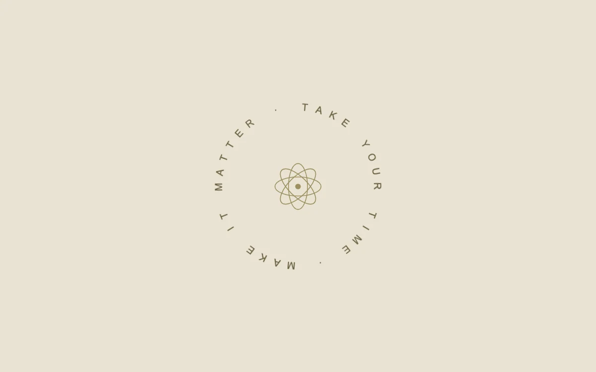

# Words in orbit

> A quiet circular label turns around a stationary center.

- **Common name:** Circular rotating text
- **Category:** Animation & motion
- **Live demo:** https://www.subframe.com/motion/spinning-text
- **Source:** Motion Primitives (adapted, MIT) — https://motion-primitives.com/docs/spinning-text · [original code](https://github.com/ibelick/motion-primitives/blob/120f64f6ca60348e251f929e9c81f11ccbe45eda/components/core/spinning-text.tsx)
- **Dependencies:** none

## Use case

Create a decorative seal, event identity or compact editorial accent.

## Interaction

Play to turn the circular label

## Look

Pale beige page with small, widely spaced olive capitals arranged in a ring around a thin line-drawn atom emblem.

## Motion

The ring of letters rotates clockwise around the fixed centre emblem in a 28 s linear CSS loop, pausing when the host deactivates it.

## How to adapt

The spin is the `sf-spinning-text-turn` keyframe on `sf-spinning-text-ring` (28s linear); each letter of `text` is placed with a per-index `rotate` and `translateY(-80px)`, so retune that radius with the phrase length. Replace the phrase and atom SVG; keep the ring's `aria-label`.

## Reduced motion

The full circular label remains in its authored position.

## Limitations

Best for a short decorative phrase. Preserve the accessible full-text label and keep important copy in ordinary reading order.

## Taxonomy

- **Components:** text
- **Triggers:** ambient
- **Techniques:** rotate, loop
- **Feel:** calm, refined
- **Contexts:** editorial, landing
- **Tags:** text, circular, ring, rotate, loop, CSS, seal, ambient
- **Also known as:** rotating badge, text on a circle, spinning seal, circular text logo
- **Surface color:** `#e9e3d2`

## Code

See [`component.tsx`](component.tsx).
