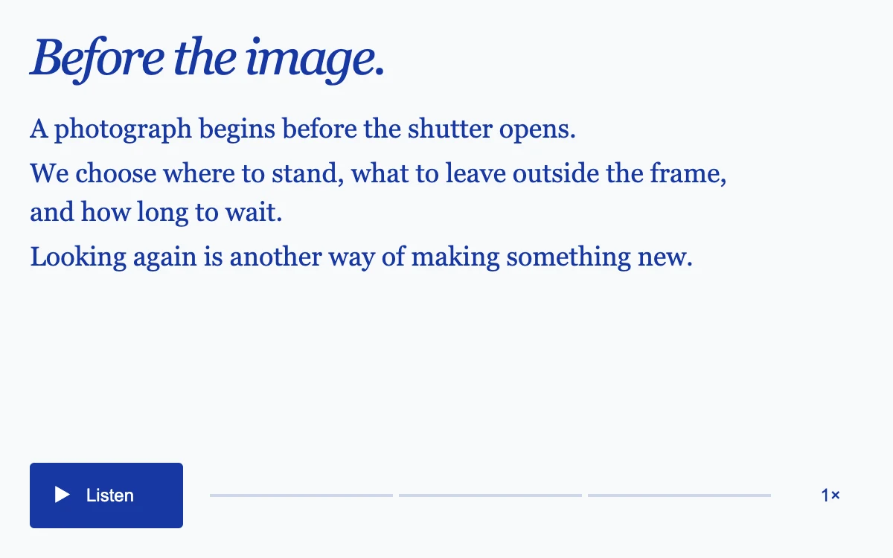

# Spoken article

> A cobalt reading card follows a short essay sentence by sentence using the browser’s own voice.

- **Common name:** Text-to-speech reader
- **Category:** Components & interactions
- **Live demo:** https://www.subframe.com/motion/spoken-article
- **Source:** Subframe (original, MIT)
- **Dependencies:** none

## Use case

Offer a spoken version of editorial content with visible position and intentional playback.

## Interaction

Listen, pause, select a sentence or change the speaking rate.

## Look

Near-white page in cobalt blue: italic serif headline, three serif sentences, a solid cobalt play button, a thin segmented progress line and rate label.

## Motion

Pressing play speaks the article with the browser's speech synthesis; the spoken sentence gets a pale blue highlight and underline, and a three-segment progress line fills, both switching instantly.

## How to adapt

Playback is `speak`, which creates one `SpeechSynthesisUtterance` per sentence, records `onboundary` offsets for resume and advances on `onend`; the highlight is `.sa-copy button[aria-current=true]`. Replace `SENTENCES` and the headline; the rate cycle sits in the `sa-rate` handler.

## Reduced motion

Sentence state changes are immediate; speech plays only after an explicit request.

## Limitations

Available voices and boundary events vary by browser and device. Resume uses the last reported word boundary; speech is not a rendered audio asset.

## Taxonomy

- **Components:** media, text
- **Triggers:** press, state
- **Techniques:** glow
- **Feel:** calm, refined
- **Contexts:** editorial
- **Tags:** speech, text-to-speech, article, playback, native, audio, editorial
- **Also known as:** read aloud button, listen to article, audio article player, sentence highlight reader, speech synthesis player
- **Surface color:** `#f8f9fc`

## Code

See [`component.tsx`](component.tsx).
