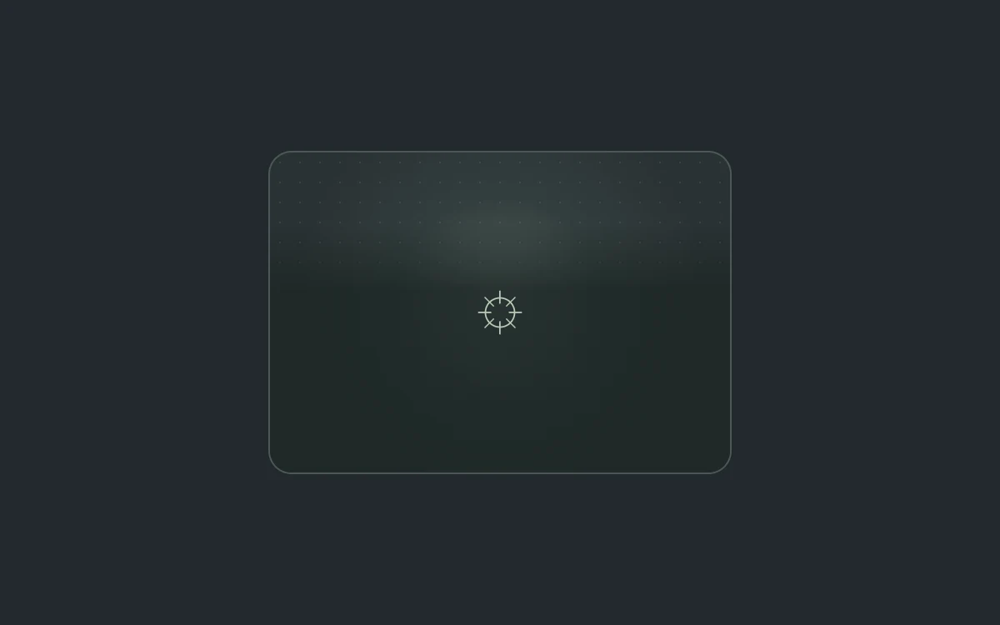

# A little light follows you

> A soft spring-driven light follows the pointer within a quiet card.

- **Common name:** Spotlight hover card
- **Category:** Components & interactions
- **Live demo:** https://www.subframe.com/motion/spotlight-card
- **Source:** Motion Primitives (adapted, MIT) — https://motion-primitives.com/docs/spotlight · [original code](https://github.com/ibelick/motion-primitives/blob/120f64f6ca60348e251f929e9c81f11ccbe45eda/components/core/spotlight.tsx)
- **Dependencies:** motion@12.0.5

## Use case

Add a subtle pointer enhancement to a featured card without moving its readable content.

## Interaction

Move your pointer across the card

## Look

Dark charcoal page with one rounded slate-green card carrying a faint dot grid, a soft pale-green glow near the top and a crosshair icon centred.

## Motion

Mouse movement over the card pulls a soft radial light after the pointer on a spring and brightens it in 0.2 s; leaving springs it back to centre, dimmed.

## How to adapt

`x` and `y` are `useSpring` values (`stiffness: 160, damping: 26`) set in `onPointerMove` and reset to the card centre (`138`, `88`) on leave; the light is the `motion.div` radial gradient with hover opacity `0.75`. Replace the dot grid and icon with your content.

## Reduced motion

The light stays centered and subdued. Touch receives the same static treatment.

## Limitations

The light is decorative. Do not rely on hover to expose content or essential state.

## Taxonomy

- **Components:** card, cursor
- **Triggers:** pointer, hover
- **Techniques:** glow, spring, gradient
- **Feel:** subtle, refined
- **Contexts:** landing, app
- **Tags:** spotlight, card, hover, pointer, radial gradient, spring, lighting
- **Also known as:** mouse follow glow, cursor glow card, radial hover highlight, pointer light effect
- **Surface color:** `#24292d`

## Code

See [`component.tsx`](component.tsx).
