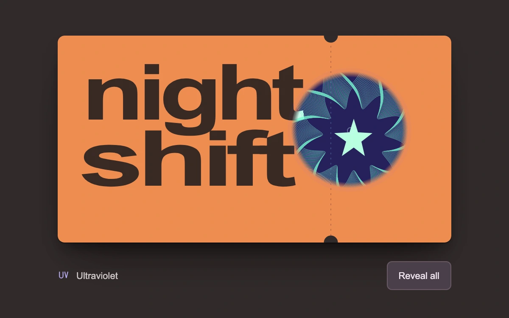

# Ultraviolet ink pass

> A fluorescent underprint appears beneath a movable ultraviolet lens on an original event pass.

- **Common name:** Spotlight reveal effect
- **Category:** Animation & motion
- **Live demo:** https://www.subframe.com/motion/spotlight-story
- **Source:** Subframe (original, MIT)
- **Dependencies:** none

## Use case

Let people inspect a hidden print layer, material finish or registered alternate state without losing the original object.

## Interaction

Move over the pass, drag the inspection lens, or reveal all the ink

## Look

Dark charcoal page holding an orange notched ticket set in heavy dark-brown sans; a round lens shows a navy underprint with mint guilloche lines.

## Motion

A 136 px lens follows the pointer or drag directly, unmasking the ultraviolet layer through a feathered radial gradient; arrow keys step it and a toggle reveals everything.

## How to adapt

The reveal is the `.sf-uv-hidden` layer's `maskImage` radial gradient centred on `point`, set by `locate`; tune its 62px/69px stops with the `.sf-uv-lens` size. Replace both `PassArtwork` variants (default and `ultraviolet`) with your base and hidden layers.

## Reduced motion

Inspection follows pointer and keyboard input immediately, without inertia or automatic motion. Control color transitions are removed.

## Limitations

Two independently authored SVG print layers and a feathered CSS mask; a visual ink demonstration, not fluorescence simulation, ticket validation or a security feature. No images, canvas or idle animation loop.

## Taxonomy

- **Components:** image, card, cursor
- **Triggers:** pointer, drag, keyboard
- **Techniques:** mask
- **Feel:** refined, playful
- **Contexts:** landing, editorial
- **Tags:** ultraviolet, UV, ink, print, ticket, pass, spotlight, mask, reveal, inspection, guilloche
- **Also known as:** flashlight reveal, hidden layer reveal, mask reveal on hover, cursor spotlight, UV light effect
- **Surface color:** `#312b2b`

## Code

See [`component.tsx`](component.tsx).
