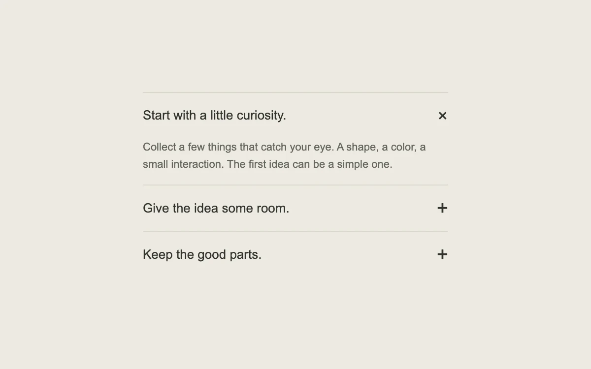

# An accordion with room to breathe

> An interruptible height transition that keeps related answers together.

- **Common name:** Animated accordion
- **Category:** Components & interactions
- **Live demo:** https://www.subframe.com/motion/spring-accordion
- **Source:** Motion Primitives (adapted, MIT) — https://motion-primitives.com/docs/accordion · [original code](https://github.com/ibelick/motion-primitives/blob/120f64f6ca60348e251f929e9c81f11ccbe45eda/components/core/accordion.tsx)
- **Dependencies:** motion@12.0.5

## Use case

Reveal short answers, feature details or a compact process without taking the user to a new page.

## Interaction

Open a different section

## Look

Warm off-white page with a narrow stack of hairline-divided rows: plain sans-serif headings, plus icons at right, and one open row showing grey body text.

## Motion

Clicking a heading springs its panel from zero to auto height with a fade (0.3 s, no bounce) as the open one collapses; the plus turns 45° into a cross.

## How to adapt

Each panel is a `motion.div` inside `AnimatePresence` animating `height` from 0 to `"auto"` with `{ type: "spring", duration: 0.3, bounce: 0 }`; the icon is a `motion.span` rotating to 45. Replace `items` with your content; `expanded` allows one open section at a time.

## Reduced motion

Sections open immediately. Keyboard activation also skips the height transition.

## Limitations

A height animation requires layout. Keep each answer short; check long content on slower devices.

## Taxonomy

- **Components:** disclosure
- **Triggers:** press
- **Techniques:** layout, spring, rotate, fade
- **Feel:** subtle, refined
- **Contexts:** landing, app
- **Tags:** accordion, FAQ, disclosure, expand, collapse, click, height, spring
- **Also known as:** FAQ accordion, expand collapse panel, collapsible sections, smooth height transition
- **Surface color:** `#eeeae2`

## Code

See [`component.tsx`](component.tsx).
